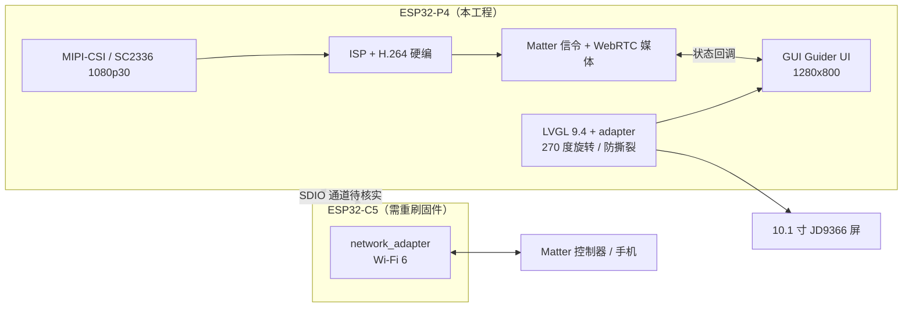

# Matter / WebRTC 摄像头方案 · 本工程适配评估

> **文档性质**：候选技术路径的**适配评估**，不是实现记录，也不是需求说明书。
>
> **方案来源**：个人笔记库 `D:\Documents\Notes\物联网\音视频\Matter-WebRTC摄像头方案.md`（工程外文件，后续可能修订）。
>
> **需求边界**：本工程"后续业务功能"用户仍未公开。本文只回答"若走这条路径，本工程缺什么、要补什么"，**不认定该方案就是最终需求**，也不据此预造 API、组件或代码。
>
> **验证状态**：2026-11-09 按本仓库源码 / `sdkconfig` / `partitions.csv` / `dependencies.lock` / 硬件 PDF，以及乐鑫公开资料整理。本机 `IDF_PATH` 为空，**未编译、未烧录、未实测**，所有"可行"均为纸面判断。
>
> **归档状态**：**当前仅作为工程文档**。按用户要求，待未来实际跑通并产出可验证结果后，再依 `AGENTS.md` 第 9 节判断是否沉淀到笔记库；本次不改动笔记库任何文件。
>
> 配套阅读：`README.md`（概览）、`AGENTS.md`（约束，尤其第 2/4/7 节）、`doc/工程介绍.md`（硬件与架构一手事实）。

---

## 0. 结论摘要

| 维度 | 判定 | 一句话 |
| --- | --- | --- |
| P4 多媒体能力 | ✅ 匹配 | H.264 / ISP / MIPI-CSI / JPEG 在 `sdkconfig` 中均为 `y`，SC2336 1080p@30 与官方规格对齐 |
| 摄像头 / 音频 / Wi-Fi 硬件 | ✅ 具备 | 板载资源齐全，但**软件全未接入** |
| 无线协处理器型号 | ⚠️ 不同 | 本工程是 **ESP32-C5**，官方示例 out-of-box 支持的是 **ESP32-C6** 板卡 |
| C5 固件形态 | ❌ 不兼容 | 现有 **AT 固件** ≠ 官方需要的 `network_adapter` / `matter_camera` |
| P4 ↔ C5 物理通道 | ❓ 待核实 | 官方走 **SDIO**；本工程手册连接图是图片页，且引脚口径存在冲突 |
| 参考硬件 / BSP | ❌ 无现成 | 官方仅支持 P4 Function EV Board、M5Stack Tab5，均非本板 |
| 应用分区容量 | ❌ 不够 | `factory` 仅 768K，装不下 Matter + KVS WebRTC + 现有图形栈 |
| 组件依赖 | ⚠️ 风险高 | `MINIMAL_BUILD ON` + 锁定版本 + 本地 LVGL override，直接叠加易冲突 |
| 算力 / 硬件资源 | ⚠️ 需实测 | 270° 旋转已持续占用 PPA / DMA2D，与图像链路可能争抢 |
| 10.1 寸屏 | ➕ 增量 | 官方参考设计没有大屏，本工程可做配网码、预览、对讲 UI |

**总体判断**：**芯片级能力基本对得上，卡点在"板级"和"软件栈"两层**。C5 固件、双芯片通道、BSP、分区这四项不解决，方案无法在本工程落地。

**三个 P0 阻塞项（动手前必须先解决）**：

1. 确认 P4 ↔ C5 实际物理通道是否为 **SDIO** 及 P4 侧 GPIO 编号（回看核心板手册连接关系图原件）。
2. 确认 **C5 能否构建并烧录**官方 `network_adapter`（Standalone）或 `matter_camera`（Split）固件；现有 AT 固件必须替换。
3. **重新规划 `partitions.csv`**，评估 Matter SDK + KVS WebRTC 的实际固件体积。

**建议**：先在**独立验证工程**里跑通 Standalone，不要直接改本工程基线；模式上优先 Standalone（理由见第 5 节）。

---

## 1. 方案要点回顾（只作锚定，不展开）

> 以下来自笔记库源文档与乐鑫公开资料，**不是本工程已实现的事实**。

| 项 | 内容 |
| --- | --- |
| 三层分工 | Matter 集群（发现、配网、能力协商、SDP/ICE 交换，**不传媒体**） / WebRTC（ICE、DTLS-SRTP，传媒体） / H.264（压缩） |
| 关键设计 | STUN/TURN 由控制器 / 生态下发到摄像头，厂商不必自建穿透基础设施 |
| 主要集群 | Camera AV Stream Management、WebRTC Transport Provider / Requestor、Push AV Stream Transport、Zone Management、AV Settings User Level Management |
| 两种模式 | Standalone（P4 全栈）、Split（信令与媒体分置两颗芯片） |
| 软件依赖 | ESP-IDF **v5.5.5**、`esp-matter/examples/camera`、`esp-port-for-amazon-kvs-sdk`（`KVS_SDK_PATH`） |
| 媒体规格 | H.264 1080p@30fps、MIPI-CSI、双向音频 |

三方选型结论（RTSP 不适合互联网远程、纯 WebRTC 需自建信令与 STUN/TURN、Matter/WebRTC 换取生态互操作）在源文档中已有论证，本文不重复，直接沿用。

---

## 2. 官方示例的准确口径（与笔记有细微差异）

按 `esp-matter` 主分支 `examples/camera` 的 README 与两个子 README（2026-11-09 检索）：

| 模式 | 实际分工 | 协处理器固件 | 烧录 |
| --- | --- | --- | --- |
| **Standalone** | P4 单芯片承担 Matter 配网/信令 + WebRTC 媒体 + 音视频采集 | **ESP32-C6 仅作 Network Adapter（Wi-Fi）**，走 SDIO | 需另烧 `${KVS_SDK_PATH}/examples/network_adapter`，`idf.py set-target esp32c6` |
| **Split** | `matter_camera`（WebRTC 信令 + Matter + 桥接）跑 **C6**；`media_adapter`（KVS `streaming_only`：采集、编码、媒体）跑 **P4** | C6 跑 Matter 协议栈与应用层 | **两套独立固件分别烧录**，SDIO Bridge 通信 |

补充事实：

- **Supported Boards 只有两块**：`ESP32-P4 Function EV Board`、`M5Stack Tab5`，均为 **P4 + ESP32-C6 + SDIO**。官方博客口径是"C5 或 C6 均可（C5 双频 / C6 2.4G），Matter 应用跑在协处理器上"，但示例仓库**没有提供 C5 的现成板卡配置**。
- Function EV Board 的 C6 **无板载 UART**，需 ESP-Prog / JTAG 才能烧录；Tab5 的 C6 下载口在背面 PCB，不在外部 USB-C。
- Split 模式的已知限制：因 C6 板上 Flash 容量，示例禁用 `ota_1`、放大 `ota_0`，**无法 OTA，官方标注"不建议用于量产"**。
- 官方参考摄像头为"兼容 ESP32-P4 的 MIPI-CSI 模组"，未指定本工程的 SC2336。

> **对本工程的含义**：C5 需要**自行移植**，不能假定把 `set-target` 换成 `esp32c5` 就能直接跑。这一条是笔记里"C5/C6 均可"与工程现实之间的主要落差。

---

## 3. 硬件能力逐项对照

| 方案要求 | 本工程实际情况 | 判定 | 依据 |
| --- | --- | --- | --- |
| 1080p@30 H.264 硬编 | `CONFIG_SOC_H264_ENCODER_SUPPORTED=y`，P4 内置 H.264 编码器 | ✅ | `sdkconfig`、工程介绍 2.1 |
| MIPI-CSI 摄像头输入 | `CONFIG_SOC_MIPI_CSI_SUPPORTED=y`；核心板 Pin 41~46（2-lane）；底板 24 MHz MCLK；CSI 复位上拉 **1.8 V**、IO 建议开漏 | ✅ | `sdkconfig`、工程介绍 3.2 / 底板 V1.3 |
| 1080p@30 传感器 | ESP32-P4-Camera：SC2336 2MP、1920×1080@30fps、8/10bit 1/2-lane MIPI ≤1.0 Gbps、RAW RGB、I2C `7'h30` | ✅ | `摄像头/ESP32-P4-摄像头.pdf`、`SC2336_数据手册_V0.7.pdf` |
| RAW → YUV 图像预处理 | `CONFIG_SOC_ISP_SUPPORTED=y`，且 demosaic / CCM / AWB / AE / LSC / sharpen / BF 等子能力齐备 | ✅ | `sdkconfig` |
| Snapshot 抓图（未来） | `CONFIG_SOC_JPEG_CODEC_SUPPORTED=y`（编 / 解码均支持） | ✅ | `sdkconfig` |
| 双向音频 | ES8311 Codec + NS4150 3 W 功放 + LMA3729T421 硅麦 | ✅ 硬件 / ⬜ 软件 | 工程介绍 2.3 |
| Wi-Fi 6 | ESP32-C5HF4（2.4 / 5 GHz、BLE 5、802.15.4）+ IPEX-1 天线座 | ✅ 硬件 / ⬜ 软件 | 工程介绍 2.1 |
| SDIO 主机 | `CONFIG_SOC_SDMMC_HOST_SUPPORTED=y`；**但 P4 ↔ C5 实际通道未核实** | ❓ | `sdkconfig` / 核心板手册图片页 |
| 大容量内存 | 32 MB HEX PSRAM @250 MHz；KVS SDK 已做"信令消息动态分配 + 优先 SPIRAM"优化 | ✅ 有基础 / ⚠️ 需实测 | 工程介绍 2.1 / 方案笔记第五节 |
| 应用固件容量 | `factory` **768K** | ❌ | `partitions.csv` |
| 现成板级 BSP | 官方仅 Function EV Board / Tab5（P4+C6） | ❌ | `examples/camera/*/README.md` |

**小结**：单看 P4 芯片与板载外设，这套方案需要的硬件几乎都齐了，甚至 JPEG 编解码为未来的 Snapshot 也留了余量。问题不在"有没有"，而在"是否已接通、固件是否是那一个、Flash 装不装得下"。

---

## 4. 关键差异与阻塞项

### 4.1 【P0】C5 固件形态完全不同 —— 最容易被忽略

- 本工程 C5 现状：开发板资料给出预编译 **AT 合并固件** `ESP32C5_2.12.9_0X0.bin`（烧 C5、地址 `0x0`）；`components/esp32at_sdio` 是空占位，git 历史中删掉的是 `esp_at_spi.c` / `app_bridge.c` / `hal_spi.c` 一类 **AT 桥接**实现。
- 官方 Standalone 要求 C6 跑 `network_adapter`；Split 要求 C6 跑 `matter_camera`（Matter 协议栈 + WebRTC 信令）。
- **AT 固件既不是 `network_adapter`，也不是 `matter_camera`**。因此现有 AT 引脚表、AT 笔记、`esp32at_sdio` 占位组件都**不能作为本方案的通道或协议依据**，C5 必须重刷。
- **利好**：本工程 C5 有独立 `U0RXD/U0TXD`（核心板 Pin 4~14），且有拨动开关切换烧录目标（**上 = P4，下 = C5**）与板载 CH343P，不需要官方那套 ESP-Prog / JTAG，双固件烧录条件反而比 Function EV Board 友好。
- **待确认**：官方是否已有 C5 版 `network_adapter` / `matter_camera`；若无，需自行把示例移植到 `esp32c5`（含双频 Wi-Fi 与引脚配置）。

### 4.2 【P0】P4 ↔ C5 到底是不是 SDIO

- 官方两个示例都建立在 **SDIO Bridge** 之上，这是方案前提。
- 本工程：核心板手册的"ESP32C5HF4 与 ESP32P4 引脚连接关系"是**图片页**，文本抽取覆盖不到，工程介绍第 2.3 节已注明"以手册原图为准"。
- 现有证据互相冲突：
  - 笔记库 `鱼鹰P4C5-AT.md` 的 P4 侧为 `SIDO_*` **GPIO14~19**（SPI / AT 风格）；
  - 核心板 88 Pin 定义里 `SD1_CDATA0~7 / CCLK / CCMD` 是 **GPIO39~48**；
  - 历史被删除的源码文件名是 `esp_at_spi.c` / `hal_spi.c`，暗示曾按 **SPI AT** 实现。
- **判定：未核实**。若实际是 SPI AT 通道，则官方 `network_adapter` / `streaming_only` 的 SDIO 桥接需要换成自定义通道实现，工作量从"移植"升级为"重写"。
- **动作**：回看 `ESP32-P4C5-Core核心板_使用指南2026.1.6.pdf` 的连接关系图与 `ESP32P4模组基础底板V1.3.pdf`，记录真实信号名、P4 侧 GPIO、电平域，回填本文与工程介绍第 3 节。

### 4.3 【P0】分区与固件体积

- 当前 `factory` 768K 只装了 LVGL 9.4 + GUI Guider 骨架 + 显示/触摸驱动；`storage` 是 15M FAT（偏移 `0x100000`）。
- 叠加 Matter SDK（connectedhomeip）+ KVS WebRTC（ICE / STUN / TURN / DTLS-SRTP）+ 摄像头 / ISP / 音频驱动后，**几乎必然溢出**。
- 旁证：官方 Split 示例因 C6 Flash 容量禁用了 `ota_1` 并标注"不建议量产" —— 说明这套栈的固件体积压力是真实存在的，不是本工程独有。
- **动作**：实测 `idf.py size` 后重规划 `partitions.csv`（app 容量、是否保留 OTA、`storage` 偏移）；大资源（字体、二维码、图片）继续放 FAT / mmap assets。改分区前按 `AGENTS.md` 第 2 节核算总 16 MB 布局。

### 4.4 【P1】参考硬件与 BSP 不同

| | 官方参考 | 本工程 |
| --- | --- | --- |
| 板卡 | ESP32-P4 Function EV Board / M5Stack Tab5 | OSPTEK ESP32-P4C5-Core + 底板 V1.3 |
| 协处理器 | ESP32-C6（模组 / 板载） | ESP32-C5HF4（核心板裸片）+ IPEX-1 |
| 摄像头 | 兼容 P4 的 MIPI-CSI 模组 | 24P 0.5 mm / 15P 1.0 mm 接口，SC2336 / OV2710 |
| 显示 | Tab5 带屏，EV Board 不带 | 10.1" JD9366 800×1280 MIPI-DSI（270° 旋转） |
| 音频 | 官方未指定 | ES8311 + NS4150 + 板载硅麦 |

因此 CSI 引脚、1.8 V 电平域、MCLK、音频 I2S、SDIO 引脚都**要自己写板级配置**，没有可直接复用的 BSP。特别注意底板 V1.3 的 **CSI 复位上拉 1.8 V**，相关 IO 建议开漏输出。

### 4.5 【P1】组件依赖与版本冲突

- `MINIMAL_BUILD ON`：新组件不写进 `REQUIRES` 就不会参与编译（现在 `main` 只 `REQUIRES spi_flash esp_psram lvgl_init guider_ui`）。
- `dependencies.lock` 固定了托管组件版本；`main/idf_component.yml` 把 `lvgl/lvgl` 用 `override_path` 指向本地 `../components/lvgl__lvgl`。
- `sdkconfig` 中 `CONFIG_MBEDTLS_VER_4_X_SUPPORT=y`；Matter SDK 对 mbedtls、lwIP、FreeRTOS 等配置较敏感，**兼容性需实际试编译确认**。
- **建议**：先在干净工程（独立 `sdkconfig`）跑通官方示例，再评估合并；不要在本工程分支上直接叠加，也不要擅自 `idf.py update-dependencies`。

### 4.6 【P1】算力与硬件资源争抢

- 本工程 270° 旋转由 `esp_lvgl_adapter` 借 **PPA / DMA2D** 持续搬运 1280×800@60Hz，且 adapter 任务已绑定 **CPU1**。
- 摄像头链路（ISP、缩放、格式转换、H.264）可能同样需要 PPA / 2D DMA → **共享硬件需排队与优先级规划**。
- 32 MB PSRAM 要同时承载：DSI 防撕裂多帧缓冲 + 1080p 编码参考帧 + WebRTC 收发缓冲 + LVGL 资源。KVS SDK 的"优先 SPIRAM"优化在此是利好，但**容量与带宽必须实测**。
- 跨核读取 DMA 写入的缓冲时，需按 ESP-IDF 规范处理缓存一致性，否则可能出现旧帧 / 花屏。
- **动作**：做任务绑核规划（媒体热路径与 UI 分开）、实测出流帧率与 UI 刷新，再定是否降预览分辨率或关旋转。

### 4.7 【P2】生态与标准进度

方案笔记第六节列的待确认项仍然成立。按 2026-11 的公开检索：SmartThings 已支持 Matter 1.5 摄像头；Apple Home / Google Home / Alexa 尚未正式发货支持；Home Assistant 在开发分支推进。这些来自第三方站点与媒体报道，**不是权威结论**，须按产品上市时间再次核对。

影响：若目标是"多生态互操作"，短期可联调的主要是 SmartThings；本地开发可用 `connectedhomeip` 的 host-based camera-controller，不必等手机 App。云侧 AI（人形 / 包裹检测）不在 Matter 标准内，仍属各家私有能力。

---

## 5. 模式选择：本工程应优先 Standalone

| | Standalone | Split |
| --- | --- | --- |
| 官方分工 | P4 全栈，C6 仅网络适配器（SDIO） | C6 跑 Matter 信令，P4 跑媒体（KVS `streaming_only`） |
| 核心价值 | 单主程序、链路短、连接建立快 | P4 闲时深睡、C6 light sleep 保网 → **电池设备** |
| 本工程匹配度 | ✅ 契合 | ❌ 收益不成立 |
| 代价 | C5 需 `network_adapter` 固件 | 两套固件 + SDIO 桥接 + 官方标注无 OTA、不建议量产 |

**理由**：Split 的全部价值在低功耗，而本工程是 5 V 输入、10.1" 大屏、SY7200 升压背光（`lcd_jd9366_backlight_set(100)` 上电即 100%）的**常亮插电 HMI 形态**，屏亮着 P4 就无法深睡。除非产品形态改为电池供电 / 屏可断电 / 事件唤醒，否则 Split 只增加复杂度而不带来收益。

**建议**：先以 Standalone 打通功能验证；Split 留作产品形态变更后的备选，且需先解决官方的 OTA 限制。

---

## 6. 与本工程显示 / UI 栈的集成点

若采用 Standalone，目标架构（**虚线处为待核实项**）：

**集成硬规则**：

1. **LVGL 线程安全**（`AGENTS.md` 第 4 节）：Matter / WebRTC 回调运行在独立任务，**不得直接创建或修改 LVGL 对象**。流状态、配网状态、对讲事件应经消息队列送到 LVGL 任务处理，或用 `esp_lv_adapter_lock(-1)` / `unlock()` 包住；锁内禁止阻塞 I/O、网络等待与长延时。
2. **10.1 寸屏是本工程相对官方参考设计的增量**：可显示 Matter 配网二维码 / manual pairing code、摄像头本地预览、双向对讲 UI、流状态与错误提示，以及 `Zone Management` 隐私遮罩区域的可视化（1280×800 画布正好够用）。
3. **预览上屏路径要单独设计**：现有 `lcd_jd9366` 只注册了 LVGL display，**没有 video layer / overlay**，不能假设 YUV 帧能直接喂给屏幕；方案未定，标"待设计"。
4. **旋转联动**：只要预览做进 UI，就仍受 270° 约束；改方向必须同步 `lvgl_init.c`、`touch_jd9366.c`、`guider.guiguider` 三处。
5. **UI 现状**：当前是键盘演示页，仅用于链路验证，不要在其上堆业务；按 `AGENTS.md` 走 GUI Guider 重新生成，或把逻辑放 `guider/custom/`。
6. **资源落点**：二维码、新字体、图片放 `storage`(FAT 15M) 或 `esp_lv_fs` / `esp_mmap_assets`，不要塞进 768K `factory`。

**音频**：ES8311 + NS4150 + 硅麦使双向通话在硬件上可行，但方案与官方示例都**未明确音频编码格式**（Opus / G.711 等），标"待确认"，不臆测；`components/` 当前也无任何音频组件，需新增驱动。

---

## 7. 若决定采用：分阶段落地路线

> 以下仅在**需求确认之后**才执行；当前阶段不写业务代码、不改基线。

| 阶段 | 目标 | 验收信号 | 前置 / 阻塞 |
| --- | --- | --- | --- |
| **P0 事实核对** | 查清 P4↔C5 通道与引脚、C5 可刷固件形态、IDF v5.5.5 环境、需求是否走此路径 | 一份通道核对记录 + 一个可编译的 C5 固件 | 核心板手册连接图原件、底板 V1.3、拨码开关验证 |
| **P1 独立验证工程** | 在干净工程跑通官方 Standalone，再移植到 C5 | 能配网、控制器能起流、1080p H.264 出流 | **不动本工程基线**；`KVS_SDK_PATH` |
| **P2 本板采集链路** | 本板 CSI + SC2336 + ISP + H.264 采集、本地环回，音频回环 | 稳定 1080p@30、无花屏 / 旧帧 | 1.8 V 电平域、24 MHz MCLK、开漏 IO、缓存一致性 |
| **P3 与基线合并** | 组件化 + 分区重规划 + 依赖对齐 + UI 状态页 | 显示 / 触摸 / UI 与流媒体共存，`idf.py size` 有余量 | 先解决 4.5 / 4.6 的冲突与争抢 |
| **P4 生态与产品化** | 控制器联调、认证、OTA、Snapshot / CMAF | 至少一家生态可稳定观看 | 生态支持进度、官方 OTA 限制、CSA 认证 |

约定：**上一阶段未跑通不进入下一阶段**；每阶段结论回填本文与工程介绍第 12 节状态表。改动代码前请按 `AGENTS.md` 第 0 节顺序阅读。

---

## 8. 待确认清单

| 编号 | 事项 | 为什么卡住 | 去哪查 / 怎么验 | 状态 |
| --- | --- | --- | --- | --- |
| T1 | P4↔C5 是否 SDIO、P4 侧 GPIO 实际编号 | 官方示例以 SDIO 为前提 | 核心板手册连接关系图 + 底板 V1.3 原理图 | ❓ 未核实 |
| T2 | C5 能否跑 `network_adapter` / `matter_camera` | 示例只列 C6 板卡 | esp-matter / KVS SDK 仓库；`set-target esp32c5` 试编译 | ❓ 未核实 |
| T3 | 现有 AT 固件是否保留双轨 | 涉及自有 App 与 Matter 的关系 | 需求方确认 | ❓ 待确认 |
| T4 | IDF v5.5.5 与 `dependencies.lock` / mbedtls 4.x / 本地 LVGL override 的兼容性 | 直接叠加易冲突 | 独立工程试编译 | ❓ 未验证 |
| T5 | 音频编码格式与 I2S 引脚 | 方案与示例均未写明 | 官方示例 + 底板原理图 | ❓ 待确认 |
| T6 | 分区方案（app 容量 / OTA / `storage` 偏移） | 768K 明显不够 | `idf.py size` 实测后重算 | ❓ 未评估 |
| T7 | PPA / DMA2D / PSRAM 带宽争抢 | 旋转已占用共享硬件 | 实测出流帧率与 UI 刷新 | ❓ 未评估 |
| T8 | 摄像头预览如何上屏 | 当前只有 LVGL display | adapter / LCD 驱动调研 | ❓ 未设计 |
| T9 | 生态控制器支持现状 | 影响联调对象 | 各生态官方支持列表，按上市时间复核 | ❓ 需复核 |
| T10 | **该方案是否为最终业务需求** | 用户尚未公布需求 | 用户确认 | ❓ **未确认** |

---

## 9. 资料与出处

**方案来源（笔记库，工程外）**

- `D:\Documents\Notes\物联网\音视频\Matter-WebRTC摄像头方案.md` —— 本文评估对象
- `D:\Documents\Notes\物联网\音视频\RTSP局域网视频通信.md` —— 同目录相关笔记，当前是待补充提纲，可作为局域网阶段占位

**乐鑫 / CSA 公开资料（2026-11-09 检索）**

- Espressif Developer Portal：《Introducing Matter Cameras》（2026-01-21）—— Matter 1.5 摄像头集群、C5/C6 分工、当前与规划特性
- `esp-matter` 仓库 `examples/camera/README.md`、`standalone/README.md`、`split_mode/README.md`（main 分支）—— 模式分工、Supported Boards、IDF v5.5.5、KVS SDK、OTA 限制
- `esp-port-for-amazon-kvs-sdk` —— `network_adapter` / `streaming_only` 示例
- CSA：Matter 1.5（2025-11）引入摄像头设备类型

**本工程一手依据**

- `sdkconfig`（`SOC_H264 / MIPI_CSI / ISP / JPEG / SDMMC` 等能力位）、`partitions.csv`、`dependencies.lock`、`main/CMakeLists.txt`、`main/idf_component.yml`
- `README.md`、`AGENTS.md`、`doc/工程介绍.md`
- 硬件 PDF：`D:\Embedded\MCU\ESP32\ESP32-P4\鱼鹰光电`（索引见工程介绍第 13 节）

> 外部资料会随版本变化；**涉及构建与烧录前，请以仓库当前 README / 源码与本机实际环境复核**。原理图与连接图多为图片页，文本提取不完整，电气结论一律以 PDF 原件为准。

---

## 10. 维护与沉淀条件

- 本文是**工程文档**，不写入 `D:\Documents\Notes`；笔记库源文件保持原样（本次零改动）。
- **沉淀条件（用户指定）**：待未来**实际做出成绩**（可验证的跑通结果，例如成功出流、配网联调记录、本板 BSP 适配成果）之后，再依 `AGENTS.md` 第 9 节判断：与工程无关的 P4 平台通用知识 / 可复用代码才可沉淀到笔记库；与本工程绑定的实现、引脚、分区、调试结论继续留在 `doc/`。
- **同步触发**：C5 固件形态、P4↔C5 通道、分区方案、组件状态、需求确认任一发生变化时，更新本文，并同步 `doc/工程介绍.md` 第 3 / 5 / 10 / 12 节与 `AGENTS.md` 第 7 节。
- **免责**：本机无 ESP-IDF 环境，文中所有可行性判断均为纸面评估，**不代表已编译验证**。
