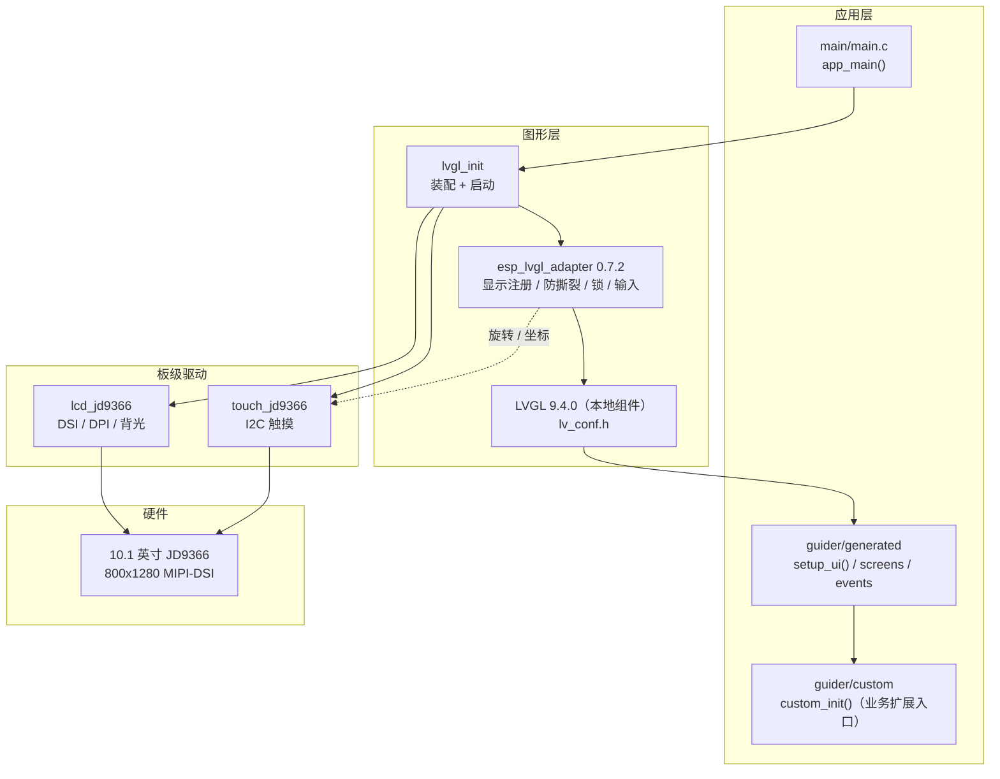

# 工程介绍 · OSPTEK ESP32-P4C5 10.1" V3.2

> **文档定位**：本工程的完整技术说明，供人与 AI 共同阅读。快速上手看根目录 `README.md`，AI 修改代码前必读 `AGENTS.md`。
>
> **信息来源**：软件事实以本仓库源码 / `sdkconfig` / `partitions.csv` / `dependencies.lock` 为第一手依据；硬件事实以 `D:\Embedded\MCU\ESP32\ESP32-P4\鱼鹰光电` 下的原厂 PDF 为依据。原理图页多为图片，文本提取可能不完整，凡涉及电气结论请以 PDF 原件复核。
>
> 整理日期：2026-11-08 · 对应仓库分支 `main` · 顶层工程名 `p4` · 文档状态依据源码、`sdkconfig` 与提交历史整理，**本次未在本机重新编译验证**

---

## 1. 项目定位与当前状态

这是一个跑在 **OSPTEK ESP32-P4C5-Module 开发板** 上的 ESP-IDF 工程，目标是打通 **10.1 英寸 MIPI-DSI 屏 + 电容触摸 + LVGL 图形界面** 这条链路，作为后续业务功能（需求待补充）的基线。

| 阶段 | 状态 |
| --- | --- |
| 显示（JD9366 / MIPI-DSI / 背光） | 已跑通 |
| 触摸（JD9366 / I2C / 旋转坐标） | 已跑通 |
| LVGL 9.4.0 + esp_lvgl_adapter（270° / 防撕裂） | 已跑通 |
| GUI Guider UI 骨架 | 已生成（键盘演示页，仅作链路验证） |
| 自定义分区表（4M app + 12032K FAT） | 已配置 |
| 摄像头 | **已接入**：`camera_preview`，MIPI-CSI → ISP → DPI 裸显 30 fps 已跑通 |
| 无线（C5） | **S2 已跑通**：本工程 `APP_MODE_NET` 接入 `esp_hosted`，`got ip` + ping 通 |
| 音频 / TF / USB | 硬件具备，软件未接入 |
| 后续业务功能 | 需求待补充，本文档不做假设 |

`app_main()` 目前只做两件事：初始化图形链路，然后加载 GUI Guider 生成的界面。整个工程刻意保持了"薄装配层 + 独立组件"的结构，便于后续插入新功能模块。

---

## 2. 硬件平台

### 2.1 核心板与开发板

| 项目 | 规格 |
| --- | --- |
| 核心板 | ESP32-P4C5-Core，88 Pin 邮票孔，25 × 25 mm |
| 主控 | ESP32-P4：2 × HP RISC-V @400 MHz + 1 × LP 内核 @40 MHz；768 KB HP L2MEM、32 KB LP SRAM、8 KB TCM |
| 多媒体 | JPEG 编 / 解码器、PPA（像素处理加速器）、ISP、H.264 编码器、MIPI CSI-2 / DSI、2D DMA |
| 无线协处理器 | ESP32-C5HF4：Wi-Fi 6（2.4 / 5 GHz）、BLE 5、IEEE 802.15.4；板载 IPEX-1 天线座 |
| 存储 | 16 MB 串行 NOR Flash（片外）+ 32 MB PSRAM（P4 封装内叠封，HEX 模式 @250 MHz） |
| 开发板 | OSPTEK ESP32-P4C5-Module 开发板，底板 V1.3，72 × 52 mm |
| 调试 | 板载 CH343P USB→UART；拨动开关切换烧录目标（上=P4，下=C5）；Type-C × 2 + USB-A Host |
| 扩展 | 2 × 2×17P 排针引出 P4 的 55 个 GPIO + C5 的 9 个 GPIO；板载 TF 卡槽 |
| 电源 | 5 V 输入 → TLV62569 降压 3.3 V；LM66200 防倒灌；MT9700 USB-A 限流；板载 1.8 V / 2.8 V LDO |

> 芯片启动配置：`CONFIG_ESP32P4_REV_MIN_301=y`，即要求 P4 芯片版本 ≥ rev 3.01；核心板手册 3.3 节列出 Strapping 脚 GPIO34~38 与启动模式（Joint Download Boot 支持 USB-Serial-JTAG / USB 2.0 OTG 下载）。

### 2.2 显示屏（10.1 英寸）

| 项目 | 规格 |
| --- | --- |
| 型号 | YDP400BT001-V4（10.1" TFT），30P 0.5 mm 上下接（背面另有 15P 1.0 mm 树莓派兼容口） |
| 驱动 IC | JD9366（LCD 与触摸同接口） |
| 原生分辨率 | **800 × 1280**（竖屏），像素格式 RGB565 |
| 接口 | MIPI-DSI **2-lane @1500 Mbps**，DBI 命令通道 + DPI 视频通道 |
| 时序 | DPI clock 78 MHz，60 Hz；h=800 / v=1280，HBP 28 / HPW 8 / HFP 40，VBP 20 / VPW 8 / VFP 140 |
| 旋转 | 硬件转屏指令不可用，由适配层 PPA / DMA2D 完成 **270°** 旋转，逻辑画布 1280 × 800 |
| 背光 | SY7200 升压恒流（底板），P4 侧 **GPIO20** 输出 LEDC PWM 控制；D-PHY 由 P4 内部 LDO 通道 3 供 2.5 V |
| 触摸 | 电容触摸，I2C，最多 5 点（`CONFIG_ESP_LCD_TOUCH_MAX_POINTS=5`） |

### 2.3 其它板载资源（硬件就位，软件未接入）

| 资源 | 说明 |
| --- | --- |
| 摄像头 | 正面 MIPI-CSI 24P 0.5 mm / 背面 15P 1.0 mm 树莓派兼容；适配 SC2336、OV2710 |
| 摄像头模组 | ESP32-P4-Camera：2MP、1920×1080@30fps、SC2336、24 PIN FPC、4P+IR 镜头 |
| 音频 | ES8311 Codec + NS4150 3 W D 类功放 + LMA3729T421 板载硅麦 + MX1.25-2P 扬声器座 |
| 无线 | ESP32-C5；原厂 AT 合并固件已弃用，现烧 ESP-Hosted 3.1.0 `cp/` 固件，P4 经 SDIO 获得标准 lwIP/socket（见 `doc/局域网RTSP与C5网卡化方案.md`） |
| 存储扩展 | TF（microSD）卡槽；片内 `storage` FAT 分区 12032 KB |

> **P4 ↔ C5 互连（2026-11-11 已按手册原图核实）**：**4-bit SDIO**，P4 侧 `CLK=18 / CMD=19 / D0~D3=14/15/16/17 / RESET=54`，C5 侧 `CLK=9 / CMD=10 / D0~D3=8/7/14/13`，另有 `C5 GPIO2 ↔ P4 GPIO6`。该组合与 ESP-Hosted 官方 P4 host + C5 slave 引脚逐脚吻合，**换固件无需改接线**。引脚定义表里的 `SD1_* GPIO39~48` 是邮票孔对外引出脚，与芯片间内部 SDIO 无关。仓库保留 `components/esp32at_sdio` 空占位（历史 AT / SPI 桥接实现已删除），AT 固件已弃用。

---

## 3. 引脚速查

### 3.1 本工程软件实际占用

| 功能 | 引脚 / 参数 | 定义位置 |
| --- | --- | --- |
| LCD 复位 | `GPIO_NUM_27` | `components/lcd_jd9366/lcd_jd9366.c` |
| LCD 背光 PWM | `GPIO_NUM_20`，LEDC TIMER0 / CH0，低速模式，10 bit，20 kHz，上电 100% | 同上（2026-11-09 由 GPIO26 修正而来） |
| 触摸 I2C | `I2C_NUM_0`，SCL `GPIO8`，SDA `GPIO7`，400 kHz，内部上拉，glitch_ignore=7 | `components/touch_jd9366/touch_jd9366.c` |
| 触摸 RST / INT | `GPIO_NUM_NC`（硬件无独立引脚） | 同上 |
| MIPI-DSI | `DSI_D0± / D1± / CLK±`（核心板 Pin 34~39），2-lane，1500 Mbps | `lcd_jd9366.c` + 核心板引脚定义 |
| MIPI D-PHY 电源 | 内部 LDO 通道 3，2500 mV | `lcd_jd9366.c` |
| 调试串口 | UART0（`GPIO37` TX / `GPIO38` RX），115200；另启用 USB-Serial-JTAG | `sdkconfig` + 核心板手册 |

> `GPIO26 / GPIO27` 在核心板引脚表中还标有 `USB1P1_N1 / P1` 复用；本工程把它们当普通 GPIO 使用，启用 USB 1.1 PHY 功能前必须重新评估。

### 3.2 系统 / 扩展关键引脚（来自核心板 88 Pin 定义）

| 范围 | 用途 |
| --- | --- |
| Pin 4~14 | C5 烧录脚（U0RXD/U0TXD）、C5 strapping（IO28/27/26）、C5 可用 GPIO（IO25/24/23/6/5/4） |
| Pin 34~39 | MIPI-DSI：D1P/N、CLKN/P、D0P/N |
| Pin 41~46 | MIPI-CSI：D0N/P、CLKP/N、D1N/P |
| Pin 48~51 | USB 2.0 OTG DM/DP；GPIO24/25（USB1P1_N0/P0） |
| GPIO34~38 | P4 Strapping / 启动模式；GPIO37/38 兼 UART0 烧录脚 |
| GPIO39~48 | `SD1_CDATA0~7 / CCLK / CCMD`（SDIO / SD 相关） |
| Pin 66 | `ESP_LDO_VO4`（0.5–2.7 V 或 3.3 V，最大 0.2 A） |
| Pin 84 | `RTC_VBAT`，**严禁悬空**（2.3–3.6 V，可接 3.3 V） |
| Pin 85/86 | `ESP_3V3` 核心板供电输入 |
| Pin 87 | `CHIP_PU`，P4 使能，内部无 RC 复位，必须外部复位 |

底板原理图（`ESP32P4模组基础底板V1.3.pdf`，单页）已按坐标裁剪放大逐处核对，**与软件直接相关**的网络 / GPIO 对照如下：

| 信号 | 底板网络 | 落到 P4 | 说明 |
| --- | --- | --- | --- |
| 触摸 I2C | `I2C_SDA_GPIO7` / `I2C_SCL_GPIO8` | GPIO7 / GPIO8 | 触摸经 `R7/R8` 0 Ω 接入 |
| 摄像头 SCCB | `CSI_SDA_1V8` / `CSI_SCL_1V8` | **GPIO7 / GPIO8（经 U5）** | **不是专用引脚，与触摸共用同一条 I2C0** |
| 摄像头复位 | `CSI_RST` | **GPIO26** → `R4` 0 Ω | `R20` 10K 上拉 **1V8**、`C5` 0.1 µF |
| 摄像头 MCLK | `MCLK`（J1.14） | 板载 X1 24 MHz 晶振（1V8）经 `R5` 0 Ω | P4 **不需要**输出 XCLK |
| 背光使能 | `U2 SY7200` 的 `EN` | **GPIO20** | `R1` 10K 上拉到 +3V3，默认常亮 |
| 触摸复位 / 中断 | `CTP_RST` / `CTP_INT` | GPIO6 / GPIO21（经 `R9/R6` 0 Ω） | 现有触摸驱动未使用这两个脚 |

U5 = **TXS0102DCUR** 电平转换：`A2(4)=CSI_SDA_1V8`、`B2(1)=I2C_SDA_GPIO7`、`A1(5)=CSI_SCL_1V8`、`B1(8)=I2C_SCL_GPIO8`、`VCCA(3)=1V8`、`VCCB(7)=+3V3`、`OE(6)=+3V3`（常使能）；3.3 V 侧另有 `R51/R52` 10K 上拉。原理图图注原文：**"摄像头复位引脚电平 1.8 V，IO 使用开漏输出"**。

> ✅ **接线矛盾已修正（2026-11-09）**：`components/lcd_jd9366/lcd_jd9366.c` 的 `LCD_BL_GPIO` 原为 `GPIO26`，与底板 V1.3 的 `CSI_RST` 抢脚；现已改为 **`GPIO20`**（U2 SY7200 EN）。修正后 `lcd_jd9366_backlight_set()` 可正常调光，GPIO26 归摄像头复位独占（启用 CSI 时按图注用**开漏**输出）。
>
> 读取原理图的注意点：Markdown 文本抽取会把网络名里的下划线转义（`CSI\_SDA\_1V8`），且**原理图自带 netlist 的文本顺序会错位一格**（实测把 `R4` 归到了 `GPIO25` 网络）。凡涉及引脚归属，一律以渲染后的图为准。

---

## 4. 软件架构



**依赖链**（由各 `CMakeLists.txt` 的 `REQUIRES` 决定）：

```
main → spi_flash, esp_psram, lvgl_init, guider_ui
lvgl_init → lvgl__lvgl, lcd_jd9366, touch_jd9366, espressif__esp_lvgl_adapter
lcd_jd9366 → esp_lcd, driver, esp_driver_ledc
touch_jd9366 → driver, esp_driver_i2c, esp_lcd, esp_lcd_touch, lcd_jd9366
guider_ui → lvgl__lvgl, lvgl_init（GLOB_RECURSE 收集 guider/generated + custom 下 .c）
lvgl__lvgl → esp_timer, freertos, driver, esp_driver_ppa, esp_mm
```

顶层 `CMakeLists.txt` 开启了 `MINIMAL_BUILD ON`，只编入 `main` 及其依赖链上的组件 —— **未被任何组件 `REQUIRES` 的目录不会参与构建**（这正是空组件 `esp32at_sdio` 目前能安静占位的原因）。

---

## 5. 组件清单

### 5.1 自研组件 `components/`

| 组件 | 职责 | 关键文件 |
| --- | --- | --- |
| `lcd_jd9366` | 面板初始化、DSI 总线 / DBI / DPI、D-PHY 供电、背光 PWM、句柄导出 | `lcd_jd9366.c/h`、`esp_lcd_jd9366.c/h`（Espressif vendor 驱动，Apache-2.0） |
| `touch_jd9366` | I2C 主机总线、触摸 IO、坐标旋转、句柄导出 | `touch_jd9366.c/h`、`esp_lcd_touch_jd9366.c/h` |
| `lvgl_init` | 计算帧缓冲数 → 初始化显示 / 触摸 → 配置并启动 adapter → 注册 display/touch | `lvgl_init.c/h` |
| `guider_ui` | 把 GUI Guider 生成代码注册为 IDF 组件（含 include 路径与 GLOB_RECURSE） | `CMakeLists.txt` |
| `lvgl__lvgl` | LVGL 9.4.0 本地副本，便于修改源码 / 配置 | `lv_conf.h`、`src/**` |
| `camera_preview` | 摄像头直显（**不依赖 LVGL**）：SC2336 800x800 RAW8@30fps → MIPI-CSI（`RAW8→RAW8` bypass，336 Mbps/2 lane，速率取 `mipi_info`）→ ISP（→RGB565 + demosaic）→ DW_GDMA 直写 DPI 帧缓冲中部 → 每帧 `draw_bitmap` 提交切 fb；含 `uniq8` / `csi_err` 健康日志与 `test_pattern` 自检开关；对外 `camera_preview_start(NULL)` | `camera_preview.c/h` |
| `esp32at_sdio` | **空占位**（仅一个空 `CMakeLists.txt`），未实现、未参与构建；历史 AT 通道，固件已弃用 | — |

### 5.2 托管组件 `managed_components/`（由组件管理器拉取）

| 组件 | 版本 | 作用 |
| --- | --- | --- |
| `espressif/esp_lvgl_adapter` | 0.7.2 | LVGL 显示 / 输入统一适配、防撕裂、线程锁（要求 idf ≥ 5.5.5） |
| `espressif/esp_lcd_touch` | 1.2.1 | 触摸框架 |
| `espressif/esp_lv_fs` / `esp_mmap_assets` | 1.0.1 / 1.0.2 | LVGL 文件系统桥接 / 资源 mmap |
| `espressif/esp_lv_decoder` / `esp_new_jpeg` | 0.4.3 / 2.0.1 | 图片 / JPEG 解码 |
| `espressif/libpng` / `zlib` / `freetype` | — | 图片与字体支持 |
| `espressif/button` / `knob` | 4.2.3 / — | 按键 / 旋钮输入（2026-11-09 组件管理器把 button 由 4.2.1 升到 4.2.3） |
| `espressif/esp_cam_sensor` | 2.6.0 | 摄像头传感器驱动集合，内含 **SC2336**（`sensors/sc2336/`）+ 自动探测框架 |
| `espressif/esp_sccb_intf` | ≥0.0.5 | SCCB（I2C 形态的摄像头控制总线）接口层，被 esp_cam_sensor 依赖 |
| `espressif/cmake_utilities` | 0.5.3 | 构建辅助 |

`dependencies.lock` 固定了以上版本；`main/idf_component.yml` 把 `lvgl/lvgl` 用 `override_path` 指向本地 `../components/lvgl__lvgl`（版本 9.4.0）。

### 5.3 GUI Guider 工程 `guider/`

| 路径 | 内容 |
| --- | --- |
| `guider.guiguider` | 工程配置：GUI Guider 2.0.1、LVGL 9.4.0、画布 1280 × 800、BlankTemplate / Simulator、创建于 2026-10-03，最后修改 2026-10-14 |
| `generated/` | `gui_guider.h`（`gg_ui_t`）、`screens/`（4 个 layer/screen 的 setup）、`events/`（事件初始化）、`assets/`（字体 / 图片声明头）、`gg_utils.c/h` |
| `custom/` | `custom.c/h`（`custom_init()` 空实现）、`lv_conf_ext.h` —— **自定义逻辑的落点** |
| `preview.png` | UI 预览：上下两个虚拟键盘（小写 / 大写模式），横屏铺满 |
| `SCR.txt` | 第三方组件与许可清单（LVGL 9.4.0 MIT、FatFs、FreeRTOS、SDL2 等） |

---

## 6. 启动流程

```
1. app_main()                                    main/main.c
2.   lvgl_init()                                 components/lvgl_init/lvgl_init.c
3.     num_fbs = esp_lv_adapter_get_required_frame_buffer_count(TEAR_AVOID_MODE, ROTATION_ANGLE)
4.     lcd_jd9366_init(num_fbs)
         4.1 esp_ldo_acquire_channel()   → LDO chan3 / 2.5 V（MIPI D-PHY）
         4.2 esp_lcd_new_dsi_bus()      → bus_id 0 / 2 lanes / 1500 Mbps
         4.3 esp_lcd_new_panel_io_dbi() → 8-bit 命令 / 参数，virtual channel 0
         4.4 JD9366_800_1280_PANEL_60HZ_DPI_CONFIG(RGB565, num_fbs)
         4.5 esp_lcd_new_panel_jd9366() → reset → init → esp_lcd_dpi_panel_enable_dma2d()
         4.6 lcd_backlight_init() + backlight_set(100) → esp_lcd_panel_disp_on_off(true)
5.     touch_jd9366_init()
         5.1 i2c_new_master_bus()       → I2C0 / GPIO8,7 / 400 kHz
         5.2 esp_lcd_new_panel_io_i2c() → ESP_LCD_TOUCH_IO_I2C_JD9366_CONFIG()
         5.3 esp_lcd_touch_new_i2c_jd9366() → swap_xy=1, mirror_y=1
6.     取句柄 → esp_lv_adapter_init(cfg.task_core_id = 1)
7.     register_display(MIPI 默认配置 + 270°) → register_touch() → esp_lv_adapter_start()
8.   esp_lv_adapter_lock(-1) → setup_ui(&guider_ui) → unlock
       setup_ui(): setup_layer_sys / top / bottom / screen → lv_screen_load(screen)
9.   ESP_LOGI("main", "UI launched")
```

所有步骤通过 `ESP_RETURN_ON_ERROR` / `ESP_RETURN_ON_FALSE` 逐级向上返回；任何一步失败都会中止后续初始化。

---

## 7. 显示子系统关键参数

| 参数 | 值 | 位置 |
| --- | --- | --- |
| 颜色 | `LCD_COLOR_FORMAT_RGB565`，16 bpp，`LCD_COLOR_FMT_RGB565` | `lcd_jd9366.h` |
| 面板尺寸 | `LCD_WIDTH=800` / `LCD_HEIGHT=1280` | 同上 |
| DSI | 2 lane，1500 Mbps，bus 0，virtual channel 0 | `lcd_jd9366.c` |
| DPI | 78 MHz，60 Hz，RGB565，帧缓冲数由 adapter 计算 | `esp_lcd_jd9366.h` |
| 旋转 | `ROTATION_ANGLE_DEG=270` → `ESP_LV_ADAPTER_ROTATE_270`；`H_RES/V_RES` 由条件编译映射 | `lvgl_init.c` |
| 防撕裂 | `ESP_LV_ADAPTER_TEAR_AVOID_MODE_DEFAULT_MIPI_DSI` | 同上 |
| 硬件加速 | `esp_lcd_dpi_panel_enable_dma2d()`；旋转由适配层硬件（PPA / DMA2D）完成，`lv_conf.h` 中 `LV_USE_PPA=0` | `lcd_jd9366.c` / `lv_conf.h` |
| adapter 任务 | 绑定 CPU1（`cfg.task_core_id = 1`） | `lvgl_init.c` |
| LVGL | 16 位色深、`LV_DEF_REFR_PERIOD 20 ms`、`LV_DPI_DEF 130`、`LV_USE_OS = LV_OS_FREERTOS`、日志开启、默认字体 Montserrat 14 | `lv_conf.h` |
| 背光 | **GPIO20** / LEDC TIMER0 / CH0 / 10 bit / 20 kHz，`lcd_jd9366_backlight_set(0~100)` | `lcd_jd9366.c` |

> 注意：`esp_lcd_jd9366.h` 里的 `JD9366_PANEL_BUS_DSI_2CH_CONFIG()` 宏给出的是 1000 Mbps 参考值，本工程**未使用该宏**，实际在 `lcd_jd9366.c` 中显式配置为 1500 Mbps。

---

## 8. 触摸子系统

| 参数 | 值 |
| --- | --- |
| 总线 | I2C0，SCL GPIO8 / SDA GPIO7，400 kHz，内部上拉，glitch_ignore_cnt=7 |
| 配置宏 | `ESP_LCD_TOUCH_IO_I2C_JD9366_CONFIG()` |
| 坐标范围 | `x_max=800`、`y_max=1280` |
| 旋转映射 | `swap_xy=1`、`mirror_x=0`、`mirror_y=1` |
| RST / INT | 均为 `GPIO_NUM_NC`（硬件未提供） |
| 多点 | `CONFIG_ESP_LCD_TOUCH_MAX_POINTS=5` |

**旋转与触摸必须联动**：改 `ROTATION_ANGLE_DEG` 却忘了改 `flags`，症状是"画面正常、点击位置错"。历史提交 `10c5c28`、`d465f03`、`b266442` 正是围绕显示 / 触摸旋转反复调整。

---

## 9. UI 子系统

- 生成器：NXP **GUI Guider 2.0.1**，生成时间 2026/10/14，工程模板 BlankTemplate / Simulator。
- 类型：`gg_ui_t` 包含 `layer_sys / layer_top / layer_bottom / screen` 四个对象组；`screen` 内有两个 `lv_keyboard`（`keyboard_1` 默认小写、`keyboard_1_copy` `LV_KEYBOARD_MODE_TEXT_UPPER`），各 1280 × 400，上下排列。
- 入口：`setup_ui(gg_ui_t *)` 依次调用四个 setup 函数并 `lv_screen_load()`；事件初始化在 `events/gg_event_*.c`；`gg_utils.c` 提供 `gg_load_screen_animation()`（基于 `lv_async_call` 的切屏封装）。
- `guider/custom/custom.c` 的 `custom_init()` 目前为空，是业务代码的推荐落点。
- 许可：生成文件带 NXP 专有许可头，重新生成会覆盖手工修改；完整第三方清单见 `guider/SCR.txt`。

---

## 10. 存储与分区

| 分区 | 类型 | 偏移 | 大小 | 用途 |
| --- | --- | --- | --- | --- |
| `nvs` | data/nvs | 0x10000 | 16K | 用户配置、Wi-Fi / BLE 配置等 |
| `phy_init` | data/phy | 0x16000 | 4K | 射频校准数据 |
| `factory` | app/factory | 0x40000 | **4M** | 应用程序（2026-11-11 S2 由 768K 扩容） |
| `storage` | data/fat | 0x440000 | **12032K** | FAT 文件系统（图片 / 字体 / 资源） |

Flash 16 MB（80 MHz），分区表位于 0xA000，使用自定义 `partitions.csv`。`sdkconfig` 还启用了 HEX PSRAM @250 MHz、L2 Cache 128 KB、FreeRTOS 1000 Hz、Task WDT 5 s、panic 后重启。

> **S2 分区扩容（2026-11-11）**：`factory` 已由 768K 扩到 **4M**，`storage` 相应收缩到 12032K 并从 `0x440000` 起；总量仍为 16 MB（`0x440000 + 0xBC0000 = 0x1000000`）。扩容原因是 GUI 镜像已占 768K 的 98%，而 ESP-Hosted / lwIP / 后续 H.264 与 RTSP 组件无法塞进原分区。大资源仍优先放 `storage`（配合 `esp_lv_fs` / `esp_mmap_assets`）。

---

## 11. 构建、烧录与调试

```bash
# 前置：激活 ESP-IDF 环境（idf.py 可用）。由 dependencies.lock 推断需 idf >= 5.5.5
idf.py set-target esp32p4          # 会重写 sdkconfig，先备份现有配置
idf.py build
idf.py -p <PORT> flash monitor     # 115200 8N1
idf.py menuconfig                  # 配置修改统一走这里
idf.py size / size-components      # 观察 factory 余量
```

- 调试串口：板载 CH343P USB→UART（P4 UART0，GPIO37/38）；`CONFIG_ESP_CONSOLE_SECONDARY_USB_SERIAL_JTAG=y` 也可用 USB-Serial-JTAG。
- 烧录目标切换：拨动开关 **上 = P4，下 = C5**。两颗芯片各自独立烧录，别烧错目标。
- C5 侧（若启用无线）：开发板资料给出的合并包 `ESP32C5_2.12.9_0X0.bin` 烧到 **0x0**，不是 0x10000；本仓库未包含该固件。
- 常见日志：`required frame buffers: N` → `lcd jd9366 init ok (800x1280)` → `touch jd9366 init ok` → `LVGL adapter init ok` → `UI launched`。

---

## 12. 已完成 / 预留未实现

| 模块 | 状态 | 说明 |
| --- | --- | --- |
| 显示 / 触摸 / LVGL / UI 骨架 | ✅ 完成 | 见第 6~9 节 |
| 分区表 / PSRAM / 芯片配置 | ✅ 完成 | 见第 10 节 |
| `components/esp32at_sdio` | ⬜ 占位 | 空 `CMakeLists.txt`；历史 AT / SPI 桥接实现已删除 |
| MIPI-CSI 摄像头（SC2336） | 裸显已跑通 | `components/camera_preview`：测试图案（彩条→灰度渐变）验证 sensor TX→CSI→ISP→DMA→DSI 全链路；镜头朝向实物后正常成像 `30 fps`、`uniq8=124~135`、`csi_err=0`。仅在 `APP_MODE_CAMERA_RAW` 下启用，详见 `doc/摄像头裸显预览方案.md` 第 8 节 |
| 音频（ES8311 / NS4150 / 硅麦） | ⬜ 硬件就绪 | 无驱动组件 |
| TF 卡 / USB Host / OTG | ⬜ 硬件就绪 | 无驱动组件 |
| Wi-Fi 6 / BLE / 802.15.4（经 C5） | ⬜ 硬件就绪 | 需先明确 P4↔C5 通道与 C5 侧固件 |
| 后续业务功能 | ❓ 需求待补充 | 不做推测 |

---

## 13. 硬件资料索引

资料根目录（本机绝对路径）：

```
D:\Embedded\MCU\ESP32\ESP32-P4\鱼鹰光电
```

| 文件 | 关键内容 | 本工程用到的部分 |
| --- | --- | --- |
| `OSPTEK ESP32-P4C5-Module 开发板.pdf` | 产品规格、板载资源、已适配屏幕 / 摄像头清单、C5 固件烧录、硬件版本 V1.1~V1.3 | 10.1" 800×1280 JD9366、SC2336 / OV2710、`ESP32C5_2.12.9_0X0.bin` @0x0 |
| `ESP32-P4C5核心板OSPTEK.pdf` | 核心板产品说明（400 MHz / 16 MB Flash / 32 MB PSRAM / 25×25 mm） | 第 2.1 节规格 |
| `ESP32-P4C5-Core核心板_使用指南2026.1.6.pdf` | 硬件参数表、88 Pin 定义、Strapping 管脚、启动模式、电气特性 | 第 3.2 节引脚、GPIO34~38 启动约束 |
| `ESP32-P4C5-Core核心板_引脚定义.pdf` | 88 Pin 速查（含 C5 引脚、DSI/CSI/USB/SD1 复用） | 第 3.2 节 |
| `ESP32-P4-Module_使用指南2026.09.10（含原理图）.pdf` | 模组功能特性、组件介绍、版本变更、原理图 | V1.3~V1.5 变更：CSI 复位上拉 1.8 V、兼容 P4C6 / P4C5 |
| `ESP32P4模组基础底板V1.3.pdf` | 底板原理图（网络名） | `TP_* / CSI_*_1V8 / LCD_RST / VLED+ / I2C_*_GPIO7/8 / 24 MHz` |
| `ESP32-P4C5-Module开发板OSPTEK.pdf` | 开发板说明（另一版导出的 README 型文档） | 与第一行互为参照 |
| `摄像头/ESP32-P4-摄像头.pdf` | 摄像头模组规格：2MP、1920×1080@30fps、24 PIN、SC2336、4P+IR、视场 D75°/H56°/V42°、YCbCr4:2:2 / RGB565 / Raw Bayer | 摄像头能力评估 |
| `摄像头/SC2336_数据手册_V0.7.pdf` | 1928×1088 像素阵列、1920×1080@30fps 10bit、8/10bit 1/2-lane MIPI（≤1.0 Gbps）、RAW RGB、I2C 设备地址 7'h30、Sensor ID 0xcb3a、AVDD 2.8 V / DOVDD 1.8 V | 后续 CSI 驱动寄存器依据 |

> 引用时请注明文件名 + 章节 / 页码。原理图与引脚连接图多为图片，文本抽取结果不完整，务必回看原页。

### 13.1 个人笔记库（工程外）

| 路径 | 内容 |
| --- | --- |
| `D:\Documents\Notes\嵌入式\01_平台层（硬件）\ESP32\P4\鱼鹰P4C5-AT.md` | P4 ↔ C5 的 SPI/SDIO AT 通道引脚速查（极简笔记，含 C5 AT 固件与烧录切换） |
| `D:\Documents\Notes\嵌入式\01_平台层（硬件）\ESP32\P4\ESP32-P4-通用代码骨架.md` | 与工程无关、与 P4 强耦合的可复用代码骨架（旋转映射、DSI/D-PHY、背光、触摸、LVGL 锁） |

分流约定：**工程相关内容写本工程 `doc/`**，平台通用知识与代码写笔记库；具体规则见 `AGENTS.md` 第 9 节。笔记库中的 AT 表 P4 侧为 GPIO14~19，与核心板引脚表的 `SD1_*` GPIO39~48 口径不同，接线前需核对手册连接图原件。

---

## 14. 扩展指南（需求明确后）

1. **加 UI 逻辑**：在 GUI Guider 工程里改界面并重新生成；纯业务逻辑放 `guider/custom/custom.c` 或新建组件，通过 `gg_ui_t` 拿对象句柄。非 LVGL 线程操作 UI 必须加 `esp_lv_adapter_lock/unlock`。
2. **加新功能模块**：新建 `components/<name>/`，写 `CMakeLists.txt`（显式 `SRCS / INCLUDE_DIRS / REQUIRES`），在 `main/CMakeLists.txt` 的 `REQUIRES` 声明，并在 `app_main()` 里做初始化装配；`MINIMAL_BUILD ON` 下不声明就不会被编译。
3. **接摄像头**：以 MIPI-CSI 2-lane（核心板 Pin 41~46）+ 24 MHz MCLK + 1.8 V I2C 为硬件起点，参考 SC2336 手册寄存器表；注意 CSI 复位为 1.8 V 域、IO 建议开漏；P4 侧可用 ISP / PPA / JPEG 编解码。
4. **接无线**：先确认 P4↔C5 的实际互连（查核心板手册连接关系图）与 C5 侧固件形态，再决定 `esp32at_sdio` 组件的实现方式；不要假设协议。
5. **放大资源**：优先放 `storage`(FAT 12032K)，配合 `esp_lv_fs` / `esp_mmap_assets`；改动 `partitions.csv` 前重新计算偏移。
6. **改方向 / 换屏**：`lcd_jd9366.h`（分辨率、色深）、`esp_lcd_jd9366.h`（DPI 时序 / 初始化命令）、`lvgl_init.c`（旋转）、`touch_jd9366.c`（坐标映射）、`guider.guiguider`（画布）五处联动。

> **候选方案评估（非需求）**：`doc/Matter-WebRTC摄像头方案适配评估.md` 针对 Matter 1.5 / WebRTC / H.264 摄像头方案做了与本工程的适配评估，逐项对照硬件能力，并列出 C5 固件形态、P4↔C5 通道、分区容量、组件依赖等阻塞项与分阶段路线。该文档是**评估稿，不代表需求已确定，也不是已实现功能**；当前仅作为工程文档，待实际跑通并产出可验证结果后再按 `AGENTS.md` 第 9 节决定是否沉淀到笔记库。

---

## 15. 已知约束与坑

| 问题 | 说明 |
| --- | --- |
| 应用分区余量 | `factory` 已扩到 4M；NET 镜像 0x8ef10 剩 86%，仍应在构建后看 `idf.py size` |
| Flash 模式配置项不一致 | `sdkconfig` 中 `CONFIG_ESPTOOLPY_FLASHMODE_QIO=y`，但 `CONFIG_ESPTOOLPY_FLASHMODE="dio"` / `FLASHMODE_VAL=1`；两者不同步，烧录前请用 `idf.py menuconfig` 重新确认并重新生成配置，不要直接判定为 QIO |
| 旋转一致性 | 显示旋转、触摸 flags、GUI Guider 画布必须同步（历史多次为此返工） |
| 屏幕排线 | 历史提交 `0b7ec1e` 确认"显示崩溃"根因是屏幕接口松动；先查硬件再改软件 |
| PSRAM 启动检查 | 历史提交 `0b7ec1e` 关闭了 PSRAM 启动时的检查，改动 `sdkconfig` 相关项需重新评估稳定性 |
| Strapping 脚 | GPIO34~38 决定启动模式 / 下载方式，随意复用会导致无法烧录 |
| 电源细节 | `RTC_VBAT` 不可悬空；D-PHY 需 LDO chan3 2.5 V；CSI 侧 1.8 V 电平域 |
| `MINIMAL_BUILD` | 新组件不写进 `REQUIRES` 就是"看起来在仓库里、其实没编译" |
| 组件版本 | `managed_components/` 会被组件管理器覆盖；`lvgl__lvgl` 是本地副本，升级前先备份改动 |
| 生成代码 | `guider/generated/**` 每次重新生成都会覆盖手改，切勿作为业务代码落点 |
| 模拟器配置 | `guider.guiguider` 的 `colorDepth: 24` / SDL2 是 PC 模拟设置，目标板以 `lv_conf.h` 的 16 位为准 |

---

## 16. 许可与术语

| 名称 | 含义 |
| --- | --- |
| JD9366 | 10.1" TFT 屏驱动 IC（本工程 LCD 与触摸共用该命名） |
| MIPI DSI / DBI / DPI | 显示串行接口 / 命令通道 / 视频通道 |
| MIPI CSI-2 | 摄像头串行接口 |
| PPA / DMA2D | P4 像素处理加速器 / 2D DMA，用于旋转与搬运 |
| esp_lvgl_adapter | 乐鑫提供的 LVGL 适配层，负责显示注册、防撕裂、线程锁、输入设备 |
| GUI Guider | NXP 的 LVGL 可视化 UI 生成器 |
| HEX PSRAM | 八线（Hex）模式的片外 PSRAM，本工程 32 MB @250 MHz |

许可：Espressif vendor 显示驱动 Apache-2.0；LVGL 9.4.0 MIT；GUI Guider 生成代码遵循 NXP 专有许可（见文件头与 `guider/SCR.txt`）；托管组件各自带 LICENSE。硬件资料版权归 OSPTEK 鱼鹰光电 / 芯片原厂所有。

---

**维护约定**：代码中的引脚、版本、分区、组件状态发生变化时，请同步更新 `README.md`、`AGENTS.md` 与本文第 3、5、7、10、12 节。
