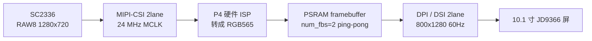

# 摄像头本地预览（裸显模式）设计

> **文档状态**：设计稿，**未实现、未编译、未实测**（本机 `IDF_PATH` 为空）。当前仅作为工程文档。
>
> **2026-11-09 补充**：第 2.1 / 2.2 节定稿组件边界与实现路径。用户提出「新建 `cam_sc2336` 组件并依赖 `lcd_jd9366`」，经核实官方已有 SC2336 驱动，调整为**单组件 `camera_preview` + 底层直连路径**；第 5 节 S1、第 6 节 B5/B6 同步修正。
>
> **来源**：用户 2026-11-09 确认的第一阶段验证目标 —— 「先做一个无条件显示摄像头内容的应用，不碰 LVGL」。
>
> **与其它文档的关系**：`doc/Matter-WebRTC摄像头方案适配评估.md` 是网络推流路径的**候选评估稿**，不是需求；本文是已确认的**第一阶段**目标，且刻意绕开协议栈与 UI。最终业务功能仍未公开。
>
> **沉淀约定**：沿用用户要求 —— 实际跑通并产出可验证结果之前，不写入 `D:\Documents\Notes`。

---

## 0. 结论

用户判断成立，且有源码级证据：**`lcd_jd9366` 是纯板级驱动，与 LVGL 零耦合；`lvgl_init` 只是它的单向消费者**。因此做一个「开机即把摄像头画面怼到屏上、不链接 LVGL、不碰协议」的应用，在本工程架构上是干净的，比走 LVGL canvas 更省事，也顺带绕开了 768K `factory` 分区与 PPA 争抢两个老问题。

上一轮把"显示端被 adapter 独占"列为卡点，那个判断**只在"与现有 GUI 共存"的前提下成立**；改成独立裸显模式后，该卡点消失。

---

## 1. 源码级耦合边界

| 组件 | `REQUIRES` | 是否依赖 LVGL |
| --- | --- | --- |
| `lcd_jd9366` | `esp_lcd driver esp_driver_ledc` | **否** |
| `touch_jd9366` | `driver esp_driver_i2c esp_lcd esp_lcd_touch lcd_jd9366` | 否 |
| `lvgl_init` | `lvgl__lvgl lcd_jd9366 touch_jd9366 espressif__esp_lvgl_adapter` | 是（消费者） |
| `guider_ui` | `lvgl__lvgl lvgl_init` | 是 |
| `main` | `spi_flash esp_psram lvgl_init guider_ui` | 是 |

依赖方向为 `main → lvgl_init → lcd_jd9366`，**没有反向依赖**。顶层 `CMakeLists.txt` 开启 `idf_build_set_property(MINIMAL_BUILD ON)`，只编入 `main` 及其依赖链 —— 所以只要 `main` 的 `REQUIRES` 里去掉 `lvgl_init` / `guider_ui`，LVGL、adapter、GUI Guider、触摸**整条链都不参与编译**，不只是"不调用"。

`lcd_jd9366` 对外提供的一切（见 `lcd_jd9366.h` / `.c`）：

| 接口 | 裸显可用性 |
| --- | --- |
| `lcd_jd9366_init(uint8_t num_fbs)` | ✅ 直接用 |
| `lcd_jd9366_get_panel()` / `get_io()` | ✅ 直接拿到 `esp_lcd_panel_handle_t` |
| `lcd_jd9366_backlight_set(0~100)` | ✅ 可用（`init` 内已设为 100） |
| `esp_lcd_dpi_panel_enable_dma2d(s_panel)` | ✅ **已在 `init` 内启用**，裸显直接受益 |
| `esp_lcd_panel_disp_on_off(s_panel, true)` | ✅ **已在 `init` 内打开**，初始化完屏即亮 |
| `JD9366_800_1280_PANEL_60HZ_DPI_CONFIG(px_format, num_fbs)` | ✅ RGB565 / 78 MHz / 60 Hz / 800×1280 |

**唯一从 LVGL 侧流入的参数是 `num_fbs`**：现由 `lvgl_init.c` 调 `esp_lv_adapter_get_required_frame_buffer_count(TEAR_AVOID_MODE, ROTATION_ANGLE)` 算出后传入。它只是一个数字，裸显模式自己传 `2`（ping-pong）即可，不构成耦合。

---

## 2. 模式落地结构（推荐）

**在本工程内加一个模式开关，默认仍为 GUI 模式**，共享同一份 `lcd_jd9366`，基线零风险：

| 文件 | 改动 |
| --- | --- |
| `main/Kconfig.projbuild`（新建） | `APP_MODE` 选择：`GUI`（默认）/ `CAMERA_RAW` |
| `main/CMakeLists.txt` | `if(CONFIG_APP_MODE_CAMERA_RAW)` → `REQUIRES spi_flash esp_psram lcd_jd9366`（S1 起再加 `camera_preview`）；否则维持现状 |
| `main/main.c` | S0 直接调 `lcd_jd9366_*` 点亮彩条；S1 起改为只调 `camera_preview_start(NULL)`；GUI 分支保持原样，头文件 include 一并包进条件编译 |
| `components/camera_preview/`（**S1 起**新建） | `camera_preview.h` + 3 个 `.c`（见 2.1）+ `CMakeLists.txt`；`REQUIRES lcd_jd9366 esp_mm esp_driver_isp esp_driver_cam esp_driver_i2c esp_lcd` |

三种落点对比：

| 方案 | 说明 | 评价 |
| --- | --- | --- |
| **A. 本工程模式开关** | 一处 Kconfig、一处条件 REQUIRES、一处条件编译 | ✅ **推荐**：正好利用现有解耦，共用板级驱动，GUI 基线可随时切回 |
| B. 独立验证工程 | 另建工程，用 `EXTRA_COMPONENT_DIRS` 指回本工程 `components/` | 最隔离，但多一套 sdkconfig / 分区表要维护 |
| C. 直接改 `main.c` + REQUIRES | 最快 | ❌ 破坏已跑通的 GUI 基线，不推荐 |

> 注意：`sdkconfig` 一律走 `idf.py menuconfig` 修改（见 `AGENTS.md` 第 2 节）；新增组件在 `MINIMAL_BUILD ON` 下必须显式写进 `REQUIRES`。

### 2.1 组件边界：为什么不需要 `cam_sc2336`

用户提出的方案是「新建 `cam_sc2336` 组件 → 依赖 `lcd_jd9366` → 一个函数直接出图」。**「一个函数」和「依赖 `lcd_jd9366`」两个判断都成立，但组件名与职责划分需要调整**：

1. **SC2336 驱动不用自己写。** 已核实官方两处现成实现：
   - 托管组件 `espressif/esp_cam_sensor`：`CONFIG_CAMERA_SC2336=y`、`sensors/sc2336/sc2336.c`、`sc2336_detect` 自动探测、默认 `RAW8 1280x720 30fps / MIPI 2lane / 24M input`，配套 `esp_video` 提供 V4L2 设备节点。
   - ESP-IDF `examples/peripherals/isp/multi_pipelines` 自带的 `sensor_init` 公共组件：SC2336 寄存器表与 SCCB 配置，可直接搬到本板。

   因此新建名为 `cam_sc2336` 的组件容易被误读成「要自己实现传感器驱动」，而实际要写的只有**板级引脚参数 + 帧搬运**。
2. **该组件装的不只是摄像头。** 它还要取 DPI 帧缓冲、做双缓冲切换与缓存同步 —— 命名应体现「预览 / 呈现」，而非某颗传感器型号。
3. **依赖 `lcd_jd9366` 是对的。** 要做到 `camera_preview_start(NULL)` 这种无参调用，组件内部必须自己拿 `esp_lcd_panel_handle_t`，那就得依赖 `lcd_jd9366`。代价是组件变成板级专用（本工程 `components/` 下其它组件本来也都是板级目录，可接受）；为将来换屏留一个 `cfg->panel` 可覆盖字段即可。

**推荐：一个组件 `camera_preview`，内部按文件分三层**（现在不拆成两个组件，避免阶段一过度设计；将来要独立复用摄像头能力时，按文件边界拆开成本极低）。

| 文件 | 职责 | 主要来源 |
| --- | --- | --- |
| `sc2336_hw.c/.h` | SCCB GPIO、reset/pwdn、MIPI 2lane 24M、SC2336 寄存器表 | 搬 IDF `sensor_init`；引脚走 Kconfig（B1~B4） |
| `capture.c` | CSI 控制器 + ISP 处理器 → RGB565 帧，`esp_cam_ctlr_receive()` 阻塞取帧 | 参照 `multi_pipelines` |
| `raw_display.c` | `get_frame_buffer()` → 写 fb → `draw_bitmap()` 零拷贝切换 + `esp_cache_msync()` | 本工程 `lcd_jd9366` |
| `camera_preview.c/.h` | 编排、起采集任务、对外唯一入口 | 新写 |

**对外 API 契约**（`camera_preview.h`）：

```c
/* 给一块 RGB565 数据就上屏；S0 彩条与 S2 摄像头帧共用同一入口 */
esp_err_t camera_preview_draw(const uint8_t *rgb565, int w, int h);

/* 启动后台流水线：返回即代表「已开始持续出图」，不是「只出一帧」 */
esp_err_t camera_preview_start(const camera_preview_config_t *cfg);  /* cfg=NULL 走默认 */

void camera_preview_stop(void);
```

要点：

- `start()` 必须起独立采集任务后**立即返回**，否则「调用一个函数就显示」会退化成「调用一次出一帧」。
- 返回的 `esp_err_t` 只表示**启动**成败；传感器没插、ISP 初始化失败等硬件错误必须如实返回，**不能为「无条件显示」吞掉错误**。
- `cfg` 为 `NULL` 时内部自行 `lcd_jd9366_init(2)` + `lcd_jd9366_get_panel()`；`cfg->panel` 非空则复用外部已初始化的面板，换屏时无需改依赖。
- `camera_preview_draw()` 单独存在，是为了覆盖「显示我要的东西」的两种理解（任意 RGB565 buffer / 摄像头帧），同时让 **S0 在零摄像头条件下即可验收**。

### 2.2 实现路径：底层直连 vs `esp_video`

官方 `multi_pipelines` 示例的 `REQUIRES` 为 `esp_mm esp_driver_isp esp_driver_cam esp_driver_i2c esp_lcd dsi_init sensor_init` —— **不经过 `esp_video` / V4L2**：主循环 `esp_cam_ctlr_receive()` 阻塞取帧，ISP 输出直接写入帧缓冲，几乎无额外拷贝，并用 ping-pong 双缓冲防撕裂。本工程已有 `lcd_jd9366` 可替代其 `dsi_init`，所以只剩 `sensor_init` 需要搬。

| | **A. 底层直连（推荐）** | B. `esp_video` + `esp_cam_sensor` |
| --- | --- | --- |
| 依赖 | IDF 内置 `esp_driver_cam/isp/i2c` + `esp_mm` + `esp_lcd` | 组件管理器新增 `espressif__esp_video` / `espressif__esp_cam_sensor` / `esp_ipa` / `esp_sccb_intf` |
| 传感器驱动 | 搬官方 `sensor_init` 寄存器表 | Kconfig 勾选即自动探测，最省事 |
| 帧接口 | `esp_cam_ctlr_receive()` 直接给地址 | V4L2 `open("/dev/video0")` + `VIDIOC_DQBUF` + ISP `/dev/video20` |
| 额外开销 | 无 VFS、无 V4L2、无 IPA JSON | VFS 虚拟文件系统数要调大、`esp_ipa` 需 `sc2336_default.json`、托管组件锁进 `dependencies.lock` |
| 对 768K `factory` | 压力最小 | 明显更大，大概率要重规划 `partitions.csv` |
| 适合 | **第一阶段「先出东西」、链路最短** | 后续要 H.264 / UVC / RTSP / 多消费者分流 |

**结论：第一阶段走 A**，与「不碰 LVGL、不碰协议、最小闭环」一致；等需要编码 / 推流 / 多消费者时再评估是否迁到 B。两条路径对 `camera_preview.h` 的对外 API 可保持一致，切换只动 `capture.c`。

> 组件管理器依赖在 CMake 中须写带命名空间的名字（如 `espressif__esp_video`）；`MINIMAL_BUILD ON` 下所有新组件都要显式进 `REQUIRES`。

---

## 3. 裸显数据流



**显示侧可用接口**（ESP-IDF v5.5.5 MIPI-DSI 文档）：

- `esp_lcd_dpi_panel_get_frame_buffer(panel, fb_num, &fb0, ...)`：取驱动按 `num_fbs` 分配的帧缓冲地址（PSRAM）。
- `esp_lcd_panel_draw_bitmap()`：按 `esp-iot-solution` 文档说明，**当传入的 `color_data` 正是 DPI 内部帧缓冲地址时，驱动不做内存拷贝，而是直接把 DMA 传输地址切到该缓冲**，从而实现多缓冲切换 —— 这是零拷贝 ping-pong 的关键，需在本板驱动上实测确认。
- `esp_lcd_dpi_panel_register_event_callbacks()`：`on_frame_buf_complete` / `on_color_trans_done` / `on_refresh_done`，用于确定"何时可安全复用某个 fb"。
- `esp_lcd_dpi_panel_set_color_conversion()`：颜色转换配置。
- `esp_lcd_dpi_panel_set_pattern()`：预定义测试图案，**不需要摄像头即可点亮屏幕**，适合做第一步验收。

**必须自己定义的契约**：谁分配 fb、谁写入、何时成为可见帧、CPU/PPA 写与 DSI DMA 读之间的缓存同步（按 IDF 规范用 `esp_cache_msync()`），以及帧切换时序。绕开 adapter 后这些责任全部落到 `camera_preview` 组件。

---

## 4. 取舍与代价

| 放弃 | 换来 |
| --- | --- |
| **270° 旋转**（由 adapter 用 PPA/DMA2D 完成） | 屏幕回到物理 **800×1280 竖屏**；摄像头 1280×720 横屏需裁切 / 居中 / 自行用 PPA 旋转 / 或先接受变形。第一阶段"先出东西"可接受 |
| 触摸与 UI（不初始化 `touch_jd9366`，不调用 `setup_ui`） | 无需 `esp_lv_adapter_lock()`，无 LVGL 线程约束 |
| GUI Guider 生成链 | `factory` 分区压力大幅下降 —— 不编 LVGL + GUI Guider + adapter |
| adapter 持续占用 PPA/DMA2D | PPA 可全部留给摄像头缩放 / 旋转 / 格式转换 |
| 防撕裂策略由 adapter 托管 | 自己用 2 个 fb + 回调做 ping-pong（`num_fbs=2`，约 2×2 MB PSRAM，比 adapter 算出的 N 个更省） |

仍需处理：

- **格式**：面板 RGB565；SC2336 是 RAW sensor（官方明确"without ISP functions"），必须开 P4 ISP 输出 RGB565，否则偏色 / 花屏。
- **SCCB 电平域**：底板网络名 `CSI_SDA_1V8 / CSI_SCL_1V8` 为 1.8 V 域，IO 建议开漏；GPIO7/8 已被触摸 I2C0 占用，**不能复用**。
- **缓存一致性**：跨核读 DMA 缓冲前按 IDF 规范同步，否则可能出现旧帧 / 花屏。
- **不要假定 SC2336 能直出 RGB565**：模组 PDF 写"YCbCr4:2:2 / RGB565 / Raw Bayer"，与乐鑫 `esp_cam_sensor` 的 RAW 口径不一致，以驱动寄存器表为准。

---

## 5. 分步验收（每步独立可验，未通过不进下一步）

| 步骤 | 做什么 | 验收信号 | 是否依赖待确认板级信息 |
| --- | --- | --- | --- |
| **S0 纯屏裸显** | 切到 `CAMERA_RAW` 模式，`main.c` 里直接 `lcd_jd9366_init(2)` → `get_panel()` → `set_pattern()` / 填彩条；**暂不建 `camera_preview` 组件** | 屏幕点亮出图案，且构建日志里**没有 LVGL / guider 组件** | **否，零依赖、零新组件**，现在就能做 |
| **S1 传感器探测** | 建 `camera_preview` 组件，按路径 A 搬 `sensor_init`、加 `esp_driver_cam/isp/i2c`，Kconfig 填 SC2336 + MIPI 2lane 24M + 开 ISP 处理器 | SCCB 读到 SC2336 的 `PID=0xcb3a`，ISP 输出缓冲有非零数据 | 需 SCCB GPIO |
| **S2 出活动画面** | CSI → ISP → RGB565 → 写 fb → ping-pong 切换 | 屏上画面随摄像头移动而变化 | 需完整板级配置 |
| **S3 优化** | 裁切 / 缩放 / PPA 旋转 / 全屏 30fps / 可选回接 LVGL | 稳定帧率、无撕裂 | — |

> S0 是这套方案最值得先做的一步：它用**现有代码、零新增依赖、零待确认参数**直接证明"不链接 LVGL 也能点亮屏"，把架构假设变成实测事实。

---

## 6. 待确认清单（S1 起才需要）

| 编号 | 事项 | 备注 |
| --- | --- | --- |
| B1 | 摄像头插 24P 0.5 mm 还是 15P 1.0 mm 接口 | 底板两种都有 |
| B2 | SCCB 的 I2C 端口与 SCL/SDA GPIO 编号 | 1.8 V 域，需回看底板 V1.3 原理图（图片页，文本提不出 GPIO 号） |
| B3 | CSI 复位脚接线与电平 | 底板 V1.3 复位上拉 1.8 V，IO 建议开漏 |
| B4 | 24 MHz MCLK 来源 | 底板原理图标有 24 MHz 网络 |
| B5 | 加入摄像头链路后 `factory` 768K 是否仍够 | `idf.py size` 实测；路径 A 压力小，路径 B 大概率要重规划 `partitions.csv` |
| B6 | VFS 最大虚拟文件系统数 | **仅路径 B 需要**：`/dev/video0` 等设备节点，第三方 P4 示例调到 10；路径 A 无此项 |

未查到的一律标"待确认"，**不虚构引脚与电气参数**；结论以硬件 PDF 原件为准。

---

## 7. 状态与同步

- 本文当前是设计稿；**未跑通不沉淀笔记库**，与 `Matter-WebRTC摄像头方案适配评估.md` 的约定一致。
- 实现落地后需同步：`README.md`（模式开关与文档导航）、`AGENTS.md` 第 7 节（阶段目标状态）、`doc/工程介绍.md` 第 5 / 10 / 12 节（组件、分区、状态表）。
- 代码若在别的机器上编译验证，请把实际日志与 `num_fbs`、帧率、`idf.py size` 结果回填本文第 5 节。
