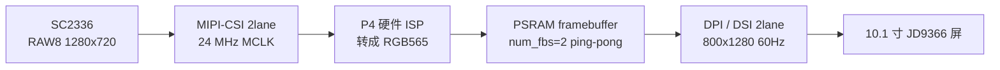

# 摄像头本地预览（裸显模式）设计

> **文档状态**：**S0（纯屏裸显）已实现、已编译、已烧录、已实测通过**（2026-11-09，ESP-IDF v6.1，COM7，本板）。S1 起仍为设计稿、未实现。当前仅作为工程文档。
>
> **2026-11-09 补充 1**：第 2.1 / 2.2 节定稿组件边界与实现路径。用户提出「新建 `cam_sc2336` 组件并依赖 `lcd_jd9366`」，经核实官方已有 SC2336 驱动，调整为**单组件 `camera_preview` + 底层直连路径**。
>
> **2026-11-09 补充 2**：S0 已落地并跑通，实测数据见第 5.1 节；构建侧发现 `MINIMAL_BUILD` 条件 `REQUIRES` 的两阶段扫描陷阱及解法，见第 2.3 节。
>
> **来源**：用户 2026-11-09 确认的第一阶段验证目标 —— 「先做一个无条件显示摄像头内容的应用，不碰 LVGL」。
>
> **与其它文档的关系**：`doc/Matter-WebRTC摄像头方案适配评估.md` 是网络推流路径的**候选评估稿**，不是需求；本文是已确认的**第一阶段**目标，且刻意绕开协议栈与 UI。最终业务功能仍未公开。
>
> **沉淀约定**：沿用用户要求 —— 实际跑通并产出可验证结果之前，不写入 `D:\Documents\Notes`。

---

## 0. 结论

用户判断成立，且有源码级证据：**`lcd_jd9366` 是纯板级驱动，与 LVGL 零耦合；`lvgl_init` 只是它的单向消费者**。因此做一个「开机即把摄像头画面怼到屏上、不链接 LVGL、不碰协议」的应用，在本工程架构上是干净的，比走 LVGL canvas 更省事，也顺带绕开了 768K `factory` 分区与 PPA 争抢两个老问题。

上一轮把"显示端被 adapter 独占"列为卡点，那个判断**只在"与现有 GUI 共存"的前提下成立**；改成独立裸显模式后，该卡点消失。

---

## 1. 源码级耦合边界

| 组件 | `REQUIRES` | 是否依赖 LVGL |
| --- | --- | --- |
| `lcd_jd9366` | `esp_lcd driver esp_driver_ledc` | **否** |
| `touch_jd9366` | `driver esp_driver_i2c esp_lcd esp_lcd_touch lcd_jd9366` | 否 |
| `lvgl_init` | `lvgl__lvgl lcd_jd9366 touch_jd9366 espressif__esp_lvgl_adapter` | 是（消费者） |
| `guider_ui` | `lvgl__lvgl lvgl_init` | 是 |
| `main` | `spi_flash esp_psram lvgl_init guider_ui` | 是 |

依赖方向为 `main → lvgl_init → lcd_jd9366`，**没有反向依赖**。顶层 `CMakeLists.txt` 开启 `idf_build_set_property(MINIMAL_BUILD ON)`，只编入 `main` 及其依赖链 —— 所以只要 `main` 的 `REQUIRES` 里去掉 `lvgl_init` / `guider_ui`，LVGL、adapter、GUI Guider、触摸**整条链都不参与编译**，不只是"不调用"。

`lcd_jd9366` 对外提供的一切（见 `lcd_jd9366.h` / `.c`）：

| 接口 | 裸显可用性 |
| --- | --- |
| `lcd_jd9366_init(uint8_t num_fbs)` | ✅ 直接用 |
| `lcd_jd9366_get_panel()` / `get_io()` | ✅ 直接拿到 `esp_lcd_panel_handle_t` |
| `lcd_jd9366_backlight_set(0~100)` | ✅ 可用（`init` 内已设为 100） |
| `esp_lcd_dpi_panel_enable_dma2d(s_panel)` | ✅ **已在 `init` 内启用**，裸显直接受益 |
| `esp_lcd_panel_disp_on_off(s_panel, true)` | ✅ **已在 `init` 内打开**，初始化完屏即亮 |
| `JD9366_800_1280_PANEL_60HZ_DPI_CONFIG(px_format, num_fbs)` | ✅ RGB565 / 78 MHz / 60 Hz / 800×1280 |

**唯一从 LVGL 侧流入的参数是 `num_fbs`**：现由 `lvgl_init.c` 调 `esp_lv_adapter_get_required_frame_buffer_count(TEAR_AVOID_MODE, ROTATION_ANGLE)` 算出后传入。它只是一个数字，裸显模式自己传 `2`（ping-pong）即可，不构成耦合。

---

## 2. 模式落地结构（推荐）

**在本工程内加一个模式开关，默认仍为 GUI 模式**，共享同一份 `lcd_jd9366`，基线零风险：

| 文件 | 改动 |
| --- | --- |
| `main/Kconfig.projbuild`（新建） | `APP_MODE` 选择：`GUI`（默认）/ `CAMERA_RAW` |
| `main/CMakeLists.txt` | `if(CONFIG_APP_MODE_CAMERA_RAW)` → `REQUIRES spi_flash esp_psram lcd_jd9366`（S1 起再加 `camera_preview`）；否则维持现状 |
| `main/main.c` | S0 直接调 `lcd_jd9366_*` 点亮彩条；S1 起改为只调 `camera_preview_start(NULL)`；GUI 分支保持原样，头文件 include 一并包进条件编译 |
| `components/camera_preview/`（**S1 起**新建） | `camera_preview.h` + 3 个 `.c`（见 2.1）+ `CMakeLists.txt`；`REQUIRES lcd_jd9366 esp_mm esp_driver_isp esp_driver_cam esp_driver_i2c esp_lcd` |

三种落点对比：

| 方案 | 说明 | 评价 |
| --- | --- | --- |
| **A. 本工程模式开关** | 一处 Kconfig、一处条件 REQUIRES、一处条件编译 | ✅ **推荐**：正好利用现有解耦，共用板级驱动，GUI 基线可随时切回 |
| B. 独立验证工程 | 另建工程，用 `EXTRA_COMPONENT_DIRS` 指回本工程 `components/` | 最隔离，但多一套 sdkconfig / 分区表要维护 |
| C. 直接改 `main.c` + REQUIRES | 最快 | ❌ 破坏已跑通的 GUI 基线，不推荐 |

> 注意：`sdkconfig` 一律走 `idf.py menuconfig` 修改（见 `AGENTS.md` 第 2 节）；新增组件在 `MINIMAL_BUILD ON` 下必须显式写进 `REQUIRES`。

### 2.1 组件边界：为什么不需要 `cam_sc2336`

用户提出的方案是「新建 `cam_sc2336` 组件 → 依赖 `lcd_jd9366` → 一个函数直接出图」。**「一个函数」和「依赖 `lcd_jd9366`」两个判断都成立，但组件名与职责划分需要调整**：

1. **SC2336 驱动不用自己写。** 已核实官方两处现成实现：
   - 托管组件 `espressif/esp_cam_sensor`：`CONFIG_CAMERA_SC2336=y`、`sensors/sc2336/sc2336.c`、`sc2336_detect` 自动探测、默认 `RAW8 1280x720 30fps / MIPI 2lane / 24M input`，配套 `esp_video` 提供 V4L2 设备节点。
   - ESP-IDF `examples/peripherals/isp/multi_pipelines` 自带的 `sensor_init` 公共组件：SC2336 寄存器表与 SCCB 配置，可直接搬到本板。

   因此新建名为 `cam_sc2336` 的组件容易被误读成「要自己实现传感器驱动」，而实际要写的只有**板级引脚参数 + 帧搬运**。
2. **该组件装的不只是摄像头。** 它还要取 DPI 帧缓冲、做双缓冲切换与缓存同步 —— 命名应体现「预览 / 呈现」，而非某颗传感器型号。
3. **依赖 `lcd_jd9366` 是对的。** 要做到 `camera_preview_start(NULL)` 这种无参调用，组件内部必须自己拿 `esp_lcd_panel_handle_t`，那就得依赖 `lcd_jd9366`。代价是组件变成板级专用（本工程 `components/` 下其它组件本来也都是板级目录，可接受）；为将来换屏留一个 `cfg->panel` 可覆盖字段即可。

**推荐：一个组件 `camera_preview`，内部按文件分三层**（现在不拆成两个组件，避免阶段一过度设计；将来要独立复用摄像头能力时，按文件边界拆开成本极低）。

| 文件 | 职责 | 主要来源 |
| --- | --- | --- |
| `sc2336_hw.c/.h` | SCCB GPIO、reset/pwdn、MIPI 2lane 24M、SC2336 寄存器表 | 搬 IDF `sensor_init`；引脚走 Kconfig（B1~B4） |
| `capture.c` | CSI 控制器 + ISP 处理器 → RGB565 帧，`esp_cam_ctlr_receive()` 阻塞取帧 | 参照 `multi_pipelines` |
| `raw_display.c` | `get_frame_buffer()` → 写 fb → `draw_bitmap()` 零拷贝切换 + `esp_cache_msync()` | 本工程 `lcd_jd9366` |
| `camera_preview.c/.h` | 编排、起采集任务、对外唯一入口 | 新写 |

**对外 API 契约**（`camera_preview.h`）：

```c
/* 给一块 RGB565 数据就上屏；S0 彩条与 S2 摄像头帧共用同一入口 */
esp_err_t camera_preview_draw(const uint8_t *rgb565, int w, int h);

/* 启动后台流水线：返回即代表「已开始持续出图」，不是「只出一帧」 */
esp_err_t camera_preview_start(const camera_preview_config_t *cfg);  /* cfg=NULL 走默认 */

void camera_preview_stop(void);
```

要点：

- `start()` 必须起独立采集任务后**立即返回**，否则「调用一个函数就显示」会退化成「调用一次出一帧」。
- 返回的 `esp_err_t` 只表示**启动**成败；传感器没插、ISP 初始化失败等硬件错误必须如实返回，**不能为「无条件显示」吞掉错误**。
- `cfg` 为 `NULL` 时内部自行 `lcd_jd9366_init(2)` + `lcd_jd9366_get_panel()`；`cfg->panel` 非空则复用外部已初始化的面板，换屏时无需改依赖。
- `camera_preview_draw()` 单独存在，是为了覆盖「显示我要的东西」的两种理解（任意 RGB565 buffer / 摄像头帧），同时让 **S0 在零摄像头条件下即可验收**。

### 2.2 实现路径：底层直连 vs `esp_video`

官方 `multi_pipelines` 示例的 `REQUIRES` 为 `esp_mm esp_driver_isp esp_driver_cam esp_driver_i2c esp_lcd dsi_init sensor_init` —— **不经过 `esp_video` / V4L2**：主循环 `esp_cam_ctlr_receive()` 阻塞取帧，ISP 输出直接写入帧缓冲，几乎无额外拷贝，并用 ping-pong 双缓冲防撕裂。本工程已有 `lcd_jd9366` 可替代其 `dsi_init`，所以只剩 `sensor_init` 需要搬。

| | **A. 底层直连（推荐）** | B. `esp_video` + `esp_cam_sensor` |
| --- | --- | --- |
| 依赖 | IDF 内置 `esp_driver_cam/isp/i2c` + `esp_mm` + `esp_lcd` | 组件管理器新增 `espressif__esp_video` / `espressif__esp_cam_sensor` / `esp_ipa` / `esp_sccb_intf` |
| 传感器驱动 | 搬官方 `sensor_init` 寄存器表 | Kconfig 勾选即自动探测，最省事 |
| 帧接口 | `esp_cam_ctlr_receive()` 直接给地址 | V4L2 `open("/dev/video0")` + `VIDIOC_DQBUF` + ISP `/dev/video20` |
| 额外开销 | 无 VFS、无 V4L2、无 IPA JSON | VFS 虚拟文件系统数要调大、`esp_ipa` 需 `sc2336_default.json`、托管组件锁进 `dependencies.lock` |
| 对 768K `factory` | 压力最小 | 明显更大，大概率要重规划 `partitions.csv` |
| 适合 | **第一阶段「先出东西」、链路最短** | 后续要 H.264 / UVC / RTSP / 多消费者分流 |

**结论：第一阶段走 A**，与「不碰 LVGL、不碰协议、最小闭环」一致；等需要编码 / 推流 / 多消费者时再评估是否迁到 B。两条路径对 `camera_preview.h` 的对外 API 可保持一致，切换只动 `capture.c`。

> 组件管理器依赖在 CMake 中须写带命名空间的名字（如 `espressif__esp_video`）；`MINIMAL_BUILD ON` 下所有新组件都要显式进 `REQUIRES`。

### 2.3 构建侧实测：`MINIMAL_BUILD` 的条件 `REQUIRES` 陷阱

S0 编译时踩到一个会让"以为切了模式、其实没切"的问题，已修好并固化在 `main/CMakeLists.txt`：

- `MINIMAL_BUILD ON` 会先跑一遍 `component_get_requirements.cmake` 做**组件发现**，此时 Kconfig 的 `CONFIG_*` **尚未导出为 CMake 变量**；第二轮正式配置时才有值。同一份 `main/CMakeLists.txt` 会被执行两次，实测诊断：
  ```
  第 1 轮：CAMERA_RAW=[]  GUI=[]
  第 2 轮：CAMERA_RAW=[y] GUI=[]
  ```
  只写 `if(CONFIG_APP_MODE_CAMERA_RAW)` 的话，第一轮会走 GUI 分支并**把 GUI 依赖链钉死**，第二轮改不回来 —— 现象是编译日志里仍出现 `guider_ui` / `lvgl_init`。
- **解法**：变量为空时回读 `sdkconfig` 文件，用 `CMAKE_CURRENT_LIST_DIR` 定位。不要用 `CMAKE_SOURCE_DIR`：第一轮它指向 `build/`，会报 `file STRINGS ... cannot be read`。
- **改完 `sdkconfig` 必须显式 `idf.py reconfigure` 再 `build`**；只跑 `build` 会重新生成 `sdkconfig.h`，但 CMake 侧的组件列表不重算。
- 裁剪结果：`guider_ui` / `lvgl_init` / `touch_jd9366` 不再进入 ninja 目标。但 `main/idf_component.yml` 声明的托管组件（`lvgl__lvgl`、`esp_lvgl_adapter`、`esp_lv_fs`、`esp_lv_decoder`）仍会编成静态库 —— `main.c` 不引用它们，链接阶段被 gc 掉，最终 `p4.bin` 仅 236K。**"不链接 LVGL"在最终镜像层面成立，不是"零次编译"**，描述时不要夸大。
- 本机 ESP-IDF 装在 `D:\Program\Espressif\v6.1\esp-idf`（EIM 安装），激活脚本 `C:\Espressif\tools\Microsoft.v6.1.PowerShell_profile.ps1`；**Git Bash / MSys 不被 IDF 6.1 支持**（报 `MSys/Mingw is no longer supported`），编译烧录需用 PowerShell 或 cmd。

---

## 3. 裸显数据流



**显示侧可用接口**（ESP-IDF v5.5.5 MIPI-DSI 文档）：

- `esp_lcd_dpi_panel_get_frame_buffer(panel, fb_num, &fb0, ...)`：取驱动按 `num_fbs` 分配的帧缓冲地址（PSRAM）。
- `esp_lcd_panel_draw_bitmap()`：按 `esp-iot-solution` 文档说明，**当传入的 `color_data` 正是 DPI 内部帧缓冲地址时，驱动不做内存拷贝，而是直接把 DMA 传输地址切到该缓冲**，从而实现多缓冲切换 —— 这是零拷贝 ping-pong 的关键，需在本板驱动上实测确认。
- `esp_lcd_dpi_panel_register_event_callbacks()`：`on_frame_buf_complete` / `on_color_trans_done` / `on_refresh_done`，用于确定"何时可安全复用某个 fb"。
- `esp_lcd_dpi_panel_set_color_conversion()`：颜色转换配置。
- `esp_lcd_dpi_panel_set_pattern()`：预定义测试图案，**不需要摄像头即可点亮屏幕**，适合做第一步验收。

**必须自己定义的契约**：谁分配 fb、谁写入、何时成为可见帧、CPU/PPA 写与 DSI DMA 读之间的缓存同步（按 IDF 规范用 `esp_cache_msync()`），以及帧切换时序。绕开 adapter 后这些责任全部落到 `camera_preview` 组件。

---

## 4. 取舍与代价

| 放弃 | 换来 |
| --- | --- |
| **270° 旋转**（由 adapter 用 PPA/DMA2D 完成） | 屏幕回到物理 **800×1280 竖屏**；摄像头 1280×720 横屏需裁切 / 居中 / 自行用 PPA 旋转 / 或先接受变形。第一阶段"先出东西"可接受 |
| 触摸与 UI（不初始化 `touch_jd9366`，不调用 `setup_ui`） | 无需 `esp_lv_adapter_lock()`，无 LVGL 线程约束 |
| GUI Guider 生成链 | `factory` 分区压力大幅下降 —— 不编 LVGL + GUI Guider + adapter |
| adapter 持续占用 PPA/DMA2D | PPA 可全部留给摄像头缩放 / 旋转 / 格式转换 |
| 防撕裂策略由 adapter 托管 | 自己用 2 个 fb + 回调做 ping-pong（`num_fbs=2`，约 2×2 MB PSRAM，比 adapter 算出的 N 个更省） |

仍需处理：

- **格式**：面板 RGB565；SC2336 是 RAW sensor（官方明确"without ISP functions"），必须开 P4 ISP 输出 RGB565，否则偏色 / 花屏。
- **SCCB 就是触摸那条 I2C0**：底板 V1.3 里 `CSI_SDA_1V8 / CSI_SCL_1V8` 并不是专用引脚，而是经 **U5（TXS0102DCUR，VCCA=1V8、VCCB=+3V3、OE 接 +3V3 常使能）** 电平转换后落到 **`GPIO7`(SDA) / `GPIO8`(SCL)**，也就是触摸面板用的同一条 I2C0（触摸另经 `R7/R8` 0 Ω）。裸显模式不初始化触摸，因此这条总线可独占；将来与 GUI 共存时总线是共享的（SC2336 与触摸地址不同，可以共存，但初始化顺序与超时要处理）。
- **缓存一致性**：跨核读 DMA 缓冲前按 IDF 规范同步，否则可能出现旧帧 / 花屏。
- **不要假定 SC2336 能直出 RGB565**：模组 PDF 写"YCbCr4:2:2 / RGB565 / Raw Bayer"，与乐鑫 `esp_cam_sensor` 的 RAW 口径不一致，以驱动寄存器表为准。

---

## 5. 分步验收（每步独立可验，未通过不进下一步）

| 步骤 | 做什么 | 验收信号 | 是否依赖待确认板级信息 |
| --- | --- | --- | --- |
| **S0 纯屏裸显** ✅ | 切到 `CAMERA_RAW` 模式，`main.c` 里直接 `lcd_jd9366_init(2)` → `get_frame_buffer()` → `set_pattern()` / 填彩条；**暂不建 `camera_preview` 组件** | **已实测通过**（5.1 节）：LCD init ok、`fbs=2`、彩条相位持续滚动、最终镜像无 GUI 链 | **否，已完成** |
| **S1 SCCB 探测** ✅ | **不建组件**，先在 `main/` 加 `cam_sccb_probe.c`：I2C0 扫总线 + 读 SC2336 `0x3107/0x3108` + 复位自证（拉低 GPIO26 看传感器是否消失） | **已实测通过**（5.2 节）：`0x30: PID=0xcb3a`、复位自证 PASS | **否，已完成** |
| **S2 出活动画面** ✅ | 新建 `camera_preview` 组件：SC2336 800x800 RAW8 → MIPI-CSI → ISP → RGB565 → **DMA 直接写 DPI 帧缓冲中部**，双缓冲 ping-pong | **已实测通过**（5.3 节）：稳定 **30 fps**，画面占屏幕中部 800×800、上下各 240 行黑边 | **否，已完成** |
| **S3 优化** | 裁切 / 缩放 / PPA 旋转 / 全屏 30fps / 可选回接 LVGL | 稳定帧率、无撕裂 | — |

> S0 用**现有代码、零新增依赖、零待确认参数**把"不链接 LVGL 也能点亮屏"从架构推断变成实测事实，已于 2026-11-09 完成。

### 5.1 S0 实测记录（2026-11-09，本板 COM7）

环境：ESP-IDF **v6.1**（`D:\Program\Espressif\v6.1\esp-idf`，EIM 安装），riscv32-esp-elf-gcc 15.2.0；`dependencies.lock` 要求 `idf: 6.1.0`，版本一致。串口 COM7（USB-Enhanced-SERIAL CH343），115200。

落地内容（仅 `main/` 下 3 个文件，**未新增组件**）：

| 文件 | 改动 |
| --- | --- |
| `main/Kconfig.projbuild`（新建） | `APP_MODE` choice：`APP_MODE_GUI`（默认）/ `APP_MODE_CAMERA_RAW` |
| `main/CMakeLists.txt` | 条件 `REQUIRES`；CAMERA_RAW 只剩 `spi_flash esp_psram esp_mm esp_lcd lcd_jd9366`（含 2.3 节的两轮扫描兜底） |
| `main/main.c` | CAMERA_RAW 分支：`lcd_jd9366_init(2)` → `get_frame_buffer()` → DSI 内置测试图案 3 秒 → 两个 fb 填 RGB565 彩条并每 2 秒滚动相位；**GUI 分支保持原样** |

构建 / 烧录结果：

- `idf.py build` 成功；`p4.bin` = **238,816 B (0x3a4e0, 236K)**；`check_sizes.py`：`factory` 0xc0000 (768K)，**剩余 0x85b20 (70%) free**。
- ninja 目标中 `guider_ui` / `lvgl__lvgl` 为 0 次；无 `error:` / `undefined reference` / `FAILED`。
- `idf.py -p COM7 flash` 成功，`Hash of data verified`，137210 压缩字节写入 0x40000。

串口日志关键行：

```
I (835) lcd_jd9366: lcd jd9366 init ok (800x1280), fbs=2
I (835) main: S0: panel handle = 0x4ffbb3a0
I (835) main: S0: fb[0] = 0x48000a40
I (836) main: S0: fb[1] = 0x481f4a80
I (839) main: S0: DSI built-in test pattern ON (3s)
I (3844) main: S0: test pattern OFF, switching to framebuffer content
I (3900) main: S0: color bar phase=0, fb_size=2048000 bytes
I (5955) main: S0: color bar phase=1, fb_size=2048000 bytes
I (8011) main: S0: color bar phase=2, fb_size=2048000 bytes
```

两个 fb 地址相差 `0x1F4040 = 2,048,000` 字节 = `800 × 1280 × 2`，与 RGB565 单帧大小完全吻合。`esp_cache_msync(..., ESP_CACHE_MSYNC_FLAG_DIR_C2M)` 未报错，相位持续推进说明主循环存活、无 WDT / 崩溃。

**结论**：「`lcd_jd9366` 与 LVGL 解耦、不链接 GUI 链也能点亮屏」已是实测事实；`get_frame_buffer()` + CPU 写 fb + 缓存同步这条 **S2 摄像头帧要走的通路也已验证可用**。屏幕画面本身需用户目视确认（本机无法读取屏幕像素）。

附带核实：

- 启动时 `rst:0x7 (HP_SYS_HP_WDT_RESET)` 是此前调试复位序列留下的复位原因记录，**不是本次运行崩溃**；后续日志连续、phase 正常推进。
- bootloader 打印 `SPI Mode: QIO` 且 `qio_mode: Enabling default flash chip QIO`，而烧录参数为 `--flash-mode dio` —— 印证 `sdkconfig` 里 `FLASHMODE_QIO=y` 与 `FLASHMODE="dio"` 不自洽这个已知坑；本板 Flash（boya）在两种模式下都能启动，量产前仍应统一。
- 裸显模式下触摸未初始化，**GPIO7/8 在这条模式下由摄像头独占**（硬件上是与触摸共用的 I2C0，见第 6 节 B2）；官方 `mipi_isp_dsi` 示例的 SCCB 默认正是 SCL=8 / SDA=7，与本板一致。

> **复现 / 回退**：改 `sdkconfig` 的 `APP_MODE` 两行 → `idf.py reconfigure` → `idf.py build` → `idf.py -p COM7 flash`。切回 GUI 基线：`git checkout -- sdkconfig`（或改回 `CONFIG_APP_MODE_GUI=y`）后**重新 reconfigure**，再 build / flash。

### 5.2 S1 实测记录（2026-11-09，本板 COM7）

代码：`main/cam_sccb_probe.{c,h}`，Kconfig 开关 `APP_CAM_S1_SCCB_PROBE`，引脚 `APP_CAM_SCCB_SDA_GPIO=7` / `APP_CAM_SCCB_SCL_GPIO=8` / `APP_CAM_RST_GPIO=26`，日志 tag `sccb`。固件 `p4.bin` 258K，烧录 `Hash of data verified`。

```
I (843) sccb: S1: SCCB SDA=GPIO7 SCL=GPIO8, reset=GPIO26 (open-drain, only on retry)
I (865) sccb: SDA=GPIO7 SCL=GPIO8 -> 4 device(s): 0x18 0x30 0x5a 0x68
W (867) sccb:   0x18: PID=0x0708 (expect 0xcb3a, not an SC2336?)
I (868) sccb:   0x30: PID=0xcb3a  <-- SC2336 matched
W (872) sccb:   0x5a: PID=0x0000 (expect 0xcb3a, not an SC2336?)
W (877) sccb:   0x68: PID=0x0000 (expect 0xcb3a, not an SC2336?)
W (882) gpio: conflict found for GPIO[26]
I (950) sccb: SDA=GPIO7 SCL=GPIO8 -> 3 device(s): 0x18 0x5a 0x68      <- 复位拉低期间，0x30 消失
I (1025) sccb: SDA=GPIO7 SCL=GPIO8 -> 4 device(s): 0x18 0x30 0x5a 0x68  <- 释放后回来
I (1042) sccb: reset self-test PASS: GPIO26 low silences the sensor, release revives it
I (1050) main: S1: SCCB probe -> OK
```

**读出来的四件事**：

1. **SC2336 在 `0x30`，PID `0xcb3a`**，与数据手册表 1-5 完全一致 —— 传感器供电、MCLK、SCCB 通路全通，**不需要再做硬件排查**。
2. **总线上的邻居反证了"共用 I2C0"**：`0x68` 正是触摸控制器地址（`ESP_LCD_TOUCH_IO_I2C_JD9366_ADDRESS`），`0x18` 是 ES8311 音频 codec 的固定地址，`0x5a` 未查证。以后与 GUI 共存时，这条总线上会同时挂触摸 + 摄像头 + codec。
3. **复位自证 PASS**：把 GPIO26 拉低 50 ms，`0x30` 从扫描结果里消失；释放 50 ms 后回来 —— 这比"看图猜引脚"硬得多，直接证明 **GPIO26 = `CSI_RST`**。
4. **`W gpio: conflict found for GPIO[26]`** 是 IDF 驱动层自己报的：`lcd_jd9366` 的 LEDC 背光占着 GPIO26，与摄像头复位抢同一个脚。这条警告正好替我们把 `LCD_BL=GPIO26` 的历史遗留问题顶了出来（真背光是 GPIO20）。

**结论**：S1 通过，S2 只剩 CSI + ISP + 帧搬运，不再有"引脚对不对"的不确定性。**未做**：CSI 数据通路、ISP 配置、RAW8→RGB565、帧写入 DSI framebuffer。

---

### 5.3 S2 实测记录（2026-11-09，本板 COM7）

**结论：摄像头画面已在屏上稳定刷新，30 fps，CPU 零搬运。**

落地内容：新建 `components/camera_preview/`（`camera_preview.c/h` + `CMakeLists.txt` + `idf_component.yml`），`main` 在 `CAMERA_RAW` 模式下改用 `camera_preview_start(NULL)` 取代 S0 的彩条。固件 **297,776 B (291K)**，768K `factory` 仍余 **62%**。

数据通路（零拷贝，CPU 不参与搬帧）：

```
SC2336 800x800 RAW8 --MIPI 2lane--> CSI bridge(bypass) --> ISP(RAW8->RGB565)
    --> DW_GDMA --> DPI 帧缓冲 fb[0]/fb[1] 的中间 800x800 区域 --> DSI 扫描输出
```

`fb` 偏移 `(1280-800)/2 * 800 * 2 = 384,000` 字节；每帧 1,280,000 字节；两个 fb 交替接收（`on_get_new_trans` 里 ping-pong），与 DPI 双缓冲扫描对齐，避免黑帧闪烁。

串口实测：

```
I (3903) sc2336: Detected Camera sensor PID=0xcb3a
I (3914) cam_prev:   fmt[1] MIPI_2lane_24Minput_RAW8_800x800_30fps
I (3987) cam_prev: format in use: MIPI_2lane_24Minput_RAW8_800x800_30fps
W (3987) ISP: precision loss, real output frequency: 120000000Hz
I (3988) cam_prev: camera preview started
I (4988) cam_prev: frames=29 (+29/s)
I (5988) cam_prev: frames=59 (+30/s)     ← 稳定 30 fps
```

**四个必须记住的坑（都在这轮踩到并解决）**：

| # | 现象 | 根因 | 解法 |
| --- | --- | --- | --- |
| 1 | `esp_cam_new_csi_ctlr()` 返回 `ESP_ERR_NOT_SUPPORTED`，日志 `failed to configure format conversion` | `esp_cam_ctlr_csi.c` 的 `s_is_color_format_conversion_supported()` **只认 RGB888/RGB565/YUV4xx，RAW8 不在白名单**。官方 `mipi_isp_dsi` 示例写的 `input=RAW8 / output=RGB565` 在本 IDF 版本上实际会失败 | 让 CSI 走 bypass（只做 PHY→DMA 搬运），RAW8→RGB565 全部交给 ISP。触发方式：把 `data_type.bits_per_pixel` 设成 **16**（非 0 使 `ctlr->custom_data_depth` 成立 → bypass），同时帧长按 RGB565 计算 |
| 2 | 初始化全过，但 `frames` 恒为 0 | `data_type_min/max` 锁成 `0x2A`（MIPI RAW8 的 data type），桥上把整帧都过滤掉了 —— 传感器的 "RAW8" 格式名不等于实际发出的 data type | 放到标准区间 **`0x12 ~ 0x2F`**，立刻出图 30 fps |
| 3 | `ESP_ERR_INVALID_ARG: no trans buffer`，每秒刷屏 | **注册了 `on_get_new_trans` 回调后，驱动不再消费 trans 队列**（源码里 `if (cbs->on_get_new_trans) {...} else if (xQueueReceiveFromISR...)`）。此时再调 `esp_cam_ctlr_receive()` 只会把队列塞满 | 有回调就**不要调 `receive()`**；`esp_cam_ctlr_start()` 会自己回调取首个 buffer 并启动 DMA。接收任务只做帧率统计 |
| 4 | 编译随机卡死（gcc CPU 0%、日志停滞 10 分钟以上） | 这台机器高并发构建时 I/O 会挂住，与代码无关；`idf.py build` 不接受 `-j` 参数 | 改用 **`ninja -j 4`**（在 `build/` 下直接跑，IDF 激活环境里执行），几十秒到几分钟稳定通过 |

其他实测值：

- `lane_bit_rate_mbps = 200`（跟随官方示例；按 336 试过也行，200 更宽松）。
- ISP `clk_hz` 请求 160 MHz，实际被分频到 **120 MHz** 并打印 precision loss 警告，工作正常。
- `bayer_order` 显式设为 `COLOR_RAW_ELEMENT_ORDER_BGGR`（与驱动 `sc2336_isp_info_mipi[]` 一致）。
- 传感器 `reset_pin = -1`：靠底板 `R20` 10K 上拉保持释放态，避免向 1.8 V 域的 `CSI_RST` 推挽输出。

**画面布局**：SC2336 的格式表里没有 800x1280，与屏幕同宽的只有 `800x800`，所以画面居中显示、上下各 240 行黑边。想铺满/旋转需要引入 PPA（`esp_driver_ppa` 已可用），属于 S3。

---

## 6. 板级参数核实结果（2026-11-09，底板 V1.3 原理图逐页核对）

依据：`ESP32P4模组基础底板V1.3.pdf` 单页原理图，用 PyMuPDF 按坐标裁剪放大逐处读图 + 原理图自带 netlist（`PIU505 / PIJ1020` 形式）双向核对。**文本抽取会漏字**（网络名里的下划线被转义成 `CSI\_SDA\_1V8`），必须看图确认。

| 编号 | 事项 | 结论 |
| --- | --- | --- |
| B1 | 摄像头接口 | 底板 **J1 = 24P**（`SC2336` 标注），pin 14 = `MCLK`、pin 16 = `VCC1V8`、pin 17 = `RESET`、pin 20 = `SDA`、pin 21 = `CLK`(SCL)、pin 23/24 = `VCC2V8`；另有 30P `J3` 走屏 + 触摸（`CTP_*`），两者不混用 |
| B2 | SCCB 端口与 GPIO | **不是专用引脚**：`CSI_SDA_1V8` / `CSI_SCL_1V8` 经 **U5 TXS0102DCUR** 转换到 **`I2C_SDA_GPIO7` / `I2C_SCL_GPIO8`**，与触摸共用 **I2C0**。U5 引脚：`B2(1)=I2C_SDA_GPIO7`、`A2(4)=CSI_SDA_1V8`、`B1(8)=I2C_SCL_GPIO8`、`A1(5)=CSI_SCL_1V8`、`VCCA(3)=1V8`、`VCCB(7)=+3V3`、`OE(6)=+3V3`（常使能）。3.3 V 侧 `R51/R52` 10K 上拉到 `+3V3` |
| B3 | CSI 复位脚 | `GPIO26` → `R4` 0 Ω → `CSI_RST`，`R20` 10K 上拉到 **1V8**，`C5` 0.1 µF 到地；图注原文：**"摄像头复位引脚电平 1.8 V，IO 使用开漏输出"** → 必须 `GPIO_MODE_INPUT_OUTPUT_OD`，禁止推挽输出高。**注意**：`lcd_jd9366.c` 的 `LCD_BL_GPIO=GPIO26` 与本底板冲突（真正背光使能是 `GPIO20`，10K 上拉常亮），上摄像头前要消解，见 `doc/工程介绍.md` 第 3 节 |
| B4 | 24 MHz MCLK | 板上 **X1 24 MHz 有源晶振**（1V8 供电）经 `R5` 0 Ω 送到 `MCLK`（J1.14），**P4 不需要输出 XCLK**；与官方示例 `MIPI_2lane_24Minput_*` 的 24M input 口径一致 |
| B5 | 加入摄像头链路后 `factory` 768K 是否够 | **S0 已实测：236K / 768K，剩余 70%**；S1/S2 加入 `esp_driver_cam/isp` 后需重测；路径 B（`esp_video`）大概率仍要重规划 `partitions.csv` |
| B6 | VFS 最大虚拟文件系统数 | **仅路径 B 需要**：`/dev/video0` 等设备节点，第三方 P4 示例调到 10；路径 A 无此项 |

引脚口径提醒：AT 表 P4 侧记的是 `SD1_*_GPIO14~19`，与核心板手册 `SD1_*` GPIO39~48 不一致；本节的 CSI/SCCB 结论**与 SDIO 无关**，两者不要混在一起推断。

---

## 7. 状态与同步

- **S0 已实测通过**（5.1 节）；**S1 SCCB 探测已实测通过**（5.2 节）。整套摄像头预览（出图）尚未跑通，**暂不沉淀笔记库**，与 `Matter-WebRTC摄像头方案适配评估.md` 的约定一致。
- 本轮（2026-11-09）已同步：`main/Kconfig.projbuild`（摄像头引脚与 S1 开关）、`main/cam_sccb_probe.{c,h}`、`main/main.c`、`main/CMakeLists.txt`；`README.md` 引脚表与进度、`AGENTS.md` 第 1 / 5 节（GPIO26 真实身份、SCCB 共用 I2C0）、`doc/工程介绍.md` 第 3 节（网络↔GPIO 对照表 + 接线矛盾）、本文档 5.2 / 6 节、`.workbuddy/memory/`。
- 待 S2 落地后再同步 `doc/工程介绍.md` 第 5 / 10 / 12 节（组件、分区、状态表）。
- 后续每步请把实际日志、帧率、`idf.py size` 结果回填第 5 节表格。

### 7.1 已知遗留（S2 前必须处理）

| 事项 | 现状 | 处理建议 |
| --- | --- | --- |
| `LCD_BL_GPIO = GPIO26` 与 `CSI_RST` 抢脚 | 底板真背光使能是 `GPIO20`（10K 上拉常亮），GPIO26 实为摄像头复位；IDF 已报 `conflict found for GPIO[26]` | ✅ **已修正（2026-11-09）**：`lcd_jd9366.c` 的 `LCD_BL_GPIO` 改为 **GPIO20**，GPIO26 归摄像头复位独占 |
| 构建偶发挂死 | 本机两次在 freetype/大文件编译处卡死（`riscv32-esp-elf-gcc` CPU 0%、日志停住数十分钟），杀掉进程后续建即可 | 完整重编约 20 分钟以上；增量编译正常。挂住就终止 `ninja` + `riscv32-esp-elf-gcc` 后重跑 `idf.py build` |
